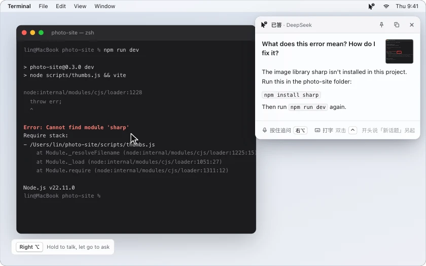
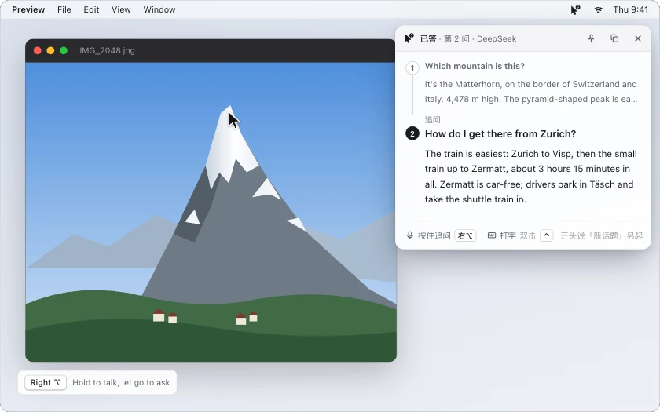
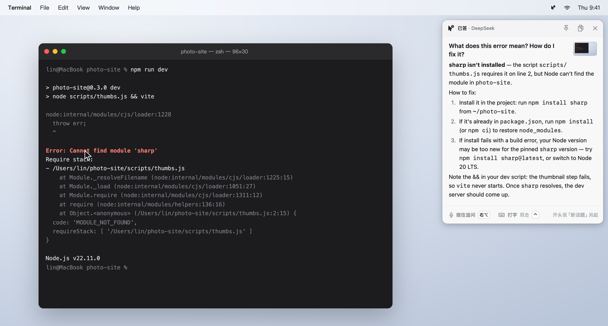
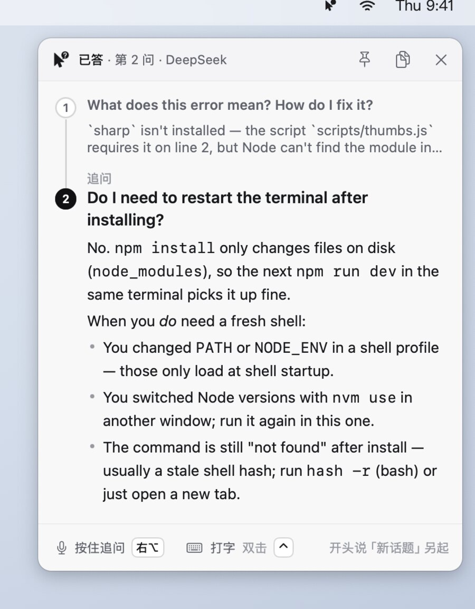
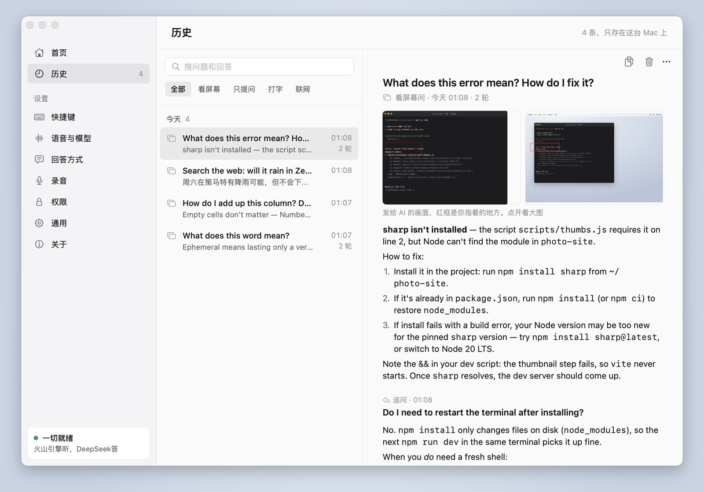
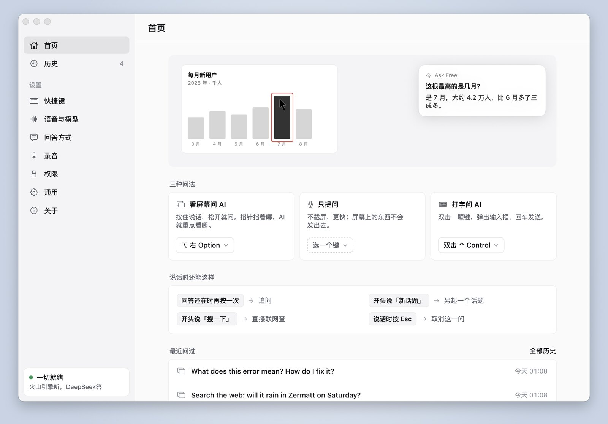
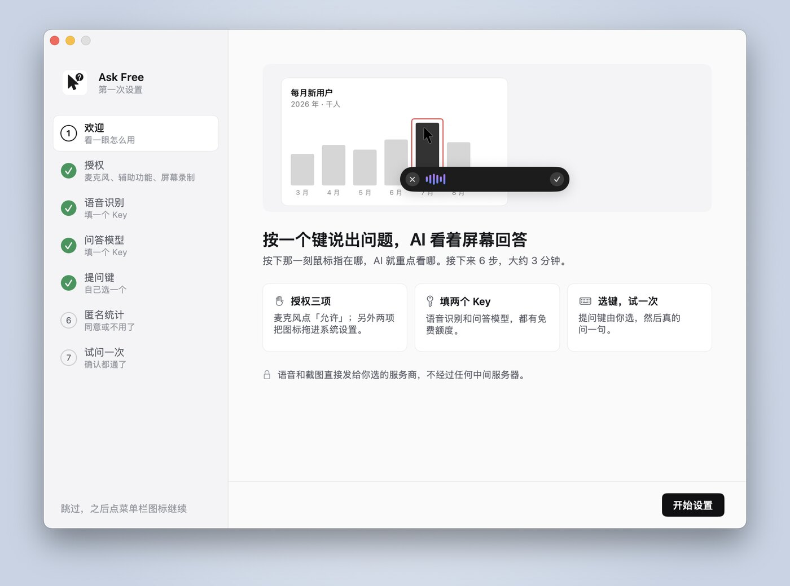
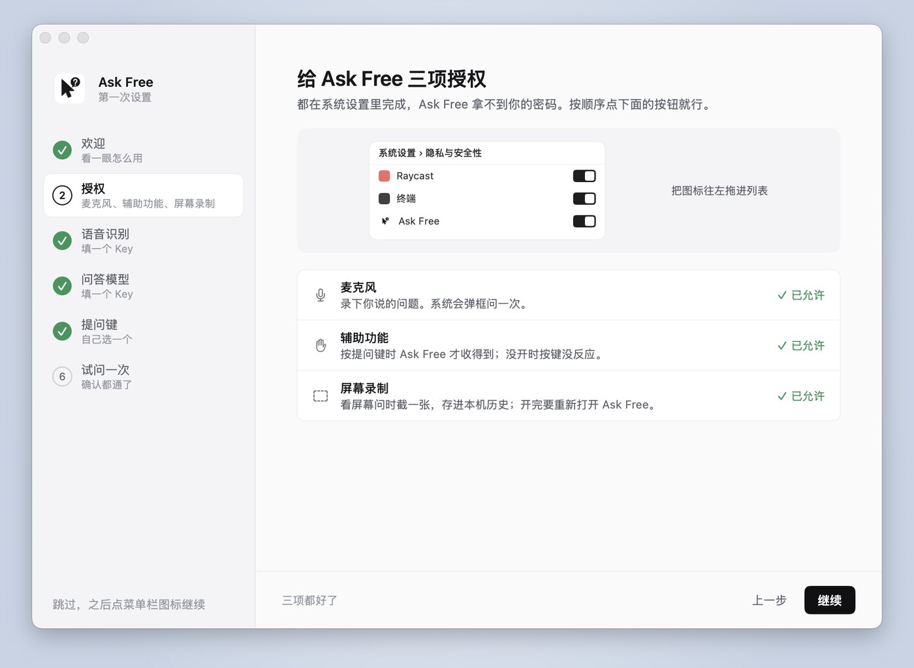

<p align="center"></p>

<h1 align="center">Ask Free</h1>

<p align="center"><b>Press a key, ask out loud, and AI answers looking at your screen.</b></p>

<p align="center"><a href="https://github.com/SchaeferAnjon/askfree/releases/latest/download/AskFree.dmg"><b>Download for Mac (Apple silicon and Intel)</b></a></p>

<p align="center"><a href="https://askfree.us-cloud.uk/"></a></p>

<p align="center">
<a href="https://github.com/SchaeferAnjon/askfree/releases/latest"></a>
<a href="LICENSE"></a>


</p>

<p align="center"><sub><b>English</b> · <a href="README.zh-CN.md">简体中文</a></sub></p>

<p align="center"></p>

> [!NOTE]
> The app's interface is in Chinese only. Speech recognition and the answer models are services based in mainland China: Volcano Engine (ByteDance) turns your voice into text, and DeepSeek or Alibaba Cloud Bailian (Qwen) answers. You either use a membership (no keys needed; we relay your questions to these services) or your own API keys from them, paid to them directly. The website and its setup guide are in Chinese too.

## What it does

You are reading a web page, a paper or some code and hit something you don't get. Point at it, hold the key, ask "what does this mean?" and let go: the answer appears in the top right corner of the screen. No switching windows, no screenshots to take, no typing. A macOS menu bar app, open source. Two ways to use it: a membership with no keys to enter (the first 100 new users get 30 free questions), or your own API keys, free forever.

- **Answers about your screen**: the moment you press the key, it captures the whole screen and the window under the pointer and sends them to the AI with your question.
- **Knows what you point at**: a red box marks where the pointer is. Ask about "this word" or "this button" and it answers about what is in the box; ask "what is this page about" and it reads the whole page.
- **Follow-up questions**: press the key again while the answer is still showing and you continue the same topic; start with 新话题 ("new topic") to start over.
- **Searches the web by itself**: for news, prices or exchange rates it looks them up; start with 搜一下 ("search") to search right away.
- **Pictures in the answer**: ask to see a photo of something and 3 images from the web appear below the answer; click one to open the original.
- **History with screenshots**: every question and answer is kept on your Mac with the screenshots sent to the AI, listed by day; search, copy or delete them.
- **Daily illustrated notes**: on the **历史** (History) page, **今天的笔记** (Today's notes) turns the day's questions into one page of notes (a summary, then each question's screenshot and the key points of its answer). Pick questions to add to Anki; open the page in your browser or export it as PDF. Writing the notes sends that day's questions and answers as text (no screenshots) to your model, or to the membership backend, where one run counts as one question.
- **Type instead**: when you can't talk, double-tap a key (Control, say), it captures the screen and you type the question.

<details>
<summary>Which languages you can ask in</summary>

- **Speaking**: according to Volcano Engine's [speech recognition docs](https://www.volcengine.com/docs/6561/1354868) (in Chinese), when no language is set (Ask Free sets none) it recognizes Mandarin Chinese and English, plus Cantonese, Shanghainese, Hokkien (Minnan), Sichuanese and Shaanxi dialect. Japanese, Korean and other languages need the language set in the request, which Ask Free does not do yet. The docs say nothing specific about mixing Chinese and English in one sentence. This is what the docs say (checked October 27, 2026); not tested.
- **Typing**: skips speech recognition, so any language DeepSeek or Qwen can read works.
- **Answers** come in the language you ask in: ask in English and it answers in English. Since 1.2.0, when a question is not in Chinese, the prompt ends by naming the language to answer in (tested on October 28, 2026 with 5 English questions to DeepSeek: all 5 answered in English).
- The interface is Chinese only.

</details>

## How to use it

<p align="center"></p>

No shortcut is set until you pick one, since every keyboard is different: the welcome guide asks you to choose one the first time (right Option, right Command, fn, Control, or record your own), and you can change it later on the **快捷键** (Shortcuts) page of the main window.

| Way to ask | How | Sees the screen |
|---|---|---|
| **Ask about the screen** | Hold the key, speak, let go to ask; or tap once to start and tap again to stop | Yes, focused on where the pointer was when you pressed |
| **Just ask** | Set a second key on the **快捷键** (Shortcuts) page; same gestures | No, faster |
| **Type** | Pick a double-tap key on the **快捷键** (Shortcuts) page (double Control, say) and type after the double tap | Yes, captures the current screen |

The answer appears in a panel in the top right corner:

- Press the key again while the answer is showing → follow-up question (keeps the context)
- Start with 新话题 ("new topic") → a new topic
- Start with 搜一下 ("search") → search the web right away
- Press Esc while speaking → cancel

**History**: the **历史** (History) page of the main window, or **历史记录** in the menu bar, lists your topics by day. Open one to see each question, answer and the screenshot sent with it; search, copy, delete with a right click, or clear everything.

## Real screenshots

<table>
<tr>
<td colspan="2" align="center"><picture><source media="(prefers-color-scheme: dark)" srcset="docs/readme/en/answer-dark.jpg"></picture><br><sub>Answering about the screen</sub></td>
</tr>
<tr>
<td align="center"><picture><source media="(prefers-color-scheme: dark)" srcset="docs/readme/en/followup-dark.jpg"></picture><br><sub>Follow-ups</sub></td>
<td align="center"><picture><source media="(prefers-color-scheme: dark)" srcset="docs/readme/en/history-dark.jpg"></picture><br><sub>History</sub></td>
</tr>
<tr>
<td colspan="2" align="center"><picture><source media="(prefers-color-scheme: dark)" srcset="docs/readme/en/home-dark.jpg"></picture><br><sub>Home page of the main window</sub></td>
</tr>
</table>

## What you need

1. A Mac with Apple silicon or an Intel chip, macOS 14 or later.
2. One of two ways to use it, picked in the **用法** (Usage) step of the welcome guide and changeable any time on the **会员** (Membership) page:
   - **Membership**: no keys to enter. Speech recognition, answers and web search go through our server; see **Membership** below.
   - **Your own keys**: free forever, nothing goes through us. You need two API keys, entered in the welcome guide or on the **语音与模型** (Voice and models) page. The [setup guide](https://askfree.us-cloud.uk/#page=setup) on the website (in Chinese) shows where to get them, step by step.
     - **Speech recognition**: Volcano Engine (Doubao) audio file recognition, [console](https://console.volcengine.com/speech/app). Each recognition version comes with 20 free hours, valid for six months.
     - **Answers**: DeepSeek (fastest, searches the web when needed, [console](https://platform.deepseek.com/api_keys)) or Qwen on Alibaba Cloud Bailian (built-in web search, [console](https://bailian.console.aliyun.com/), 1 million free tokens per model, valid for 90 days after you sign up).
     - Recognition and answers are billed by each provider to your own account at their prices: [Volcano Engine](https://www.volcengine.com/docs/6561/1359370), [DeepSeek](https://api-docs.deepseek.com/quick_start/pricing), [Alibaba Cloud Bailian](https://help.aliyun.com/zh/model-studio/model-pricing).
3. Three system permissions: Microphone, Accessibility (for the global shortcut) and Screen Recording (for asking about the screen).

## Membership

- **Free trial**: the first 100 new users get 30 free questions per Mac, with no expiry. The trial is claimed the first time you ask as a member, open the **会员** (Membership) page, or click **领取免费试用** (Get the free trial) in the welcome guide.
- **Subscription**: CNY 9.9 or USD 1.99 a month, CNY 99 or USD 19.9 a year. Stripe renews it automatically; cancel any time and it lasts to the end of the period.
- **One-off with WeChat Pay**: paying in CNY, you can also buy 1 month (CNY 9.9) or 1 year (CNY 99) once. It does not renew and adds on after your current end date.
- **200 questions a day**, reset at 8:00 Beijing time. Recognition, the answer, web searches and retries within 15 minutes all count as one question.
- **Two Macs**: after you buy you get a license code; enter it on the **会员** page of another Mac. One code works on up to 2 Macs.
- **Manage your subscription** (change card, switch monthly and yearly, cancel, see invoices): click **管理订阅** (Manage subscription) on the **会员** page. Without the app, or on a new Mac, open the [subscription login page](https://billing.stripe.com/p/login/28EaEQ7Ia9ir3ohabR2Nq00), enter the email you paid with and follow the link it sends.
- **Your own keys stay free forever**, with no limit on questions. You can switch between membership and your own keys any time.

## Install

| | Download | Needs |
|---|---|---|
| **Mac** (one universal app for Apple silicon and Intel) | [AskFree.dmg](https://github.com/SchaeferAnjon/askfree/releases/latest/download/AskFree.dmg) (latest version) | macOS 14 or later |

Open the downloaded `AskFree.dmg`, drag **Ask Free** onto the **Applications** folder next to it, and open it from **Applications**. Don't open it straight from the dmg window or from **Downloads**: macOS would run it from a temporary read-only location and forget the permissions you gave it.

**Updates**: from 1.2.0 on, Ask Free checks GitHub for a new version every 6 hours, downloads it in the background and verifies its signature, then offers **重启更新** (Restart to update) in the menu bar and under **通用 → 更新** (General → Updates) in the main window; if you don't click it, the update installs the next time you quit. You can turn this off under **通用 → 更新**. Version 1.1.0 and earlier can't update themselves: download 1.2.0 once by hand. Earlier versions and the notes for each release are on the [releases page](https://github.com/SchaeferAnjon/askfree/releases).

<details>
<summary>The first time you open it</summary>

- **macOS says “Apple could not verify ‘Ask Free’ is free of malware…”** (on macOS 14: “Apple cannot check it for malicious software”): Ask Free has a Developer ID signature but is not notarized by Apple. Open **System Settings**, go to **Privacy & Security**, scroll to the bottom and click **Open Anyway**.
- **The welcome guide**: welcome, permissions, how to use it (membership or your own keys), shortcut, anonymous usage statistics (agree or not), and finally one real question to check everything works. With your own keys there are two more steps for the speech recognition and answer keys. It takes about 3 minutes.

<p align="center"> </p>

- **Permissions**: for the microphone, click **Allow** in the system prompt. For Accessibility and Screen Recording, click **打开系统设置** (Open System Settings): an Ask Free icon floats next to System Settings; drag it to the left into the list and the switch turns on. After Screen Recording, macOS asks you to quit and reopen Ask Free; the guide comes back to the same step.
- **Upgrading from 1.0.1**: macOS may ask for Accessibility and Screen Recording again. On the **权限** (Permissions) page of the main window, click **打开系统设置** and drag the icon into the list.

</details>

## Privacy

- No account, no sign-up.
- **With your own keys**, your questions, recordings and screenshots go straight to the providers you choose, never through us:
  - Your voice goes straight to Volcano Engine to be turned into text. Recordings are not kept.
  - Your question and the screenshots go to the answer model you chose, DeepSeek or Alibaba Cloud Bailian.
  - Web searches go to the same provider: DeepSeek's search API, or Qwen's built-in web search.
- **With a membership**, the recording, the question text and the screenshots go to our server (api.us-cloud.uk), which passes them on to Volcano Engine (speech recognition) and DeepSeek (answers and web search) and sends the result back. The server does not keep recordings, screenshots, questions or answers; it records only how much each question used (whether it counted, tokens, recognition time, searches).
  - When the trial is claimed, Ask Free sends a device ID: a hash of this Mac's hardware ID and the app name, which the server hashes again with a salt before storing. It also sends the platform, chip and version; the server keeps only the platform. The server records your network range (IPv4 /24, IPv6 /48) to limit how many trials one network gets per day, never the full IP address.
  - Payments are handled by Stripe; we never see card numbers. Stripe tells us the payment email, the Stripe customer ID and the subscription status, which we use to issue the license code and know how long the membership lasts.
- The screen is captured only at the moment you press the key (or double-tap the typing key): a scaled-down image of the whole screen and a sharp one of the window under the pointer. The "just ask" key captures nothing, and nothing is captured with **让 AI 看屏幕** (Let AI see the screen) turned off on the **回答方式** (Answers) page.
- **联网的回答附上图** (Pictures with web answers) is on by default: when the answer needs pictures, one image search term (or your question, if there is no term) goes to DuckDuckGo, never the screenshots or the recording. Turn it off on the **回答方式** (Answers) page.
- Update checks: every 6 hours Ask Free fetches the latest version info from GitHub and downloads the new version if there is one; none of your questions, recordings, screenshots or keys go with it. Turn it off under **通用 → 更新** (General → Updates).
- Anonymous usage statistics: we will give the first 100 users free credit, so we need to count how many people use Ask Free. The count is anonymous. Ask Free asks you the first time you open it and **sends only if you agree**: once a day, to our server (api.us-cloud.uk), a random ID (created the first time it is sent, unrelated to your name, email or hardware), which app it is (Ask Free), the version, the system and chip type, whether you use a membership or your own keys, and the interface language. Never your questions, answers, recordings, screenshots or keys. Change it any time under **通用 → 匿名使用统计** (General → Anonymous usage statistics).
- Keys and the membership token are stored in the macOS Keychain. History and screenshots stay on your Mac in `~/.config/askfree/`, readable only by your user account: text in `history.jsonl`, the screenshots sent to the model and thumbnails of found images in `history-images/`. Delete single entries or everything on the **历史** (History) page; the daily notes (`day-notes/`) and exported notes pages (`notes/`) go with them.

The full [privacy policy](https://askfree.us-cloud.uk/#page=privacy) is on the website (in Chinese).

## Build from source

Builds with Xcode 26.3 (earlier versions not tried).

```bash
bash scripts/install_app.sh   # build and install to /Applications/Ask Free.app
bash build.sh                 # build only, output in dist/Ask Free.app
bash scripts/dev_run.sh       # build and start the development build Ask Free Dev (own settings, leaves the release build alone)
```

The Xcode project is generated from `project.yml` by [XcodeGen](https://github.com/yonaskolb/XcodeGen). After adding or removing source files, run `xcodegen generate` (`build.sh` runs it when xcodegen is installed).

The core logic lives in the Swift package `AskFreeCore`. Unit tests:

```bash
cd AskFreeCore && swift test
```

## Layout

```
Sources/        The app's interface: menu bar, recording capsule, answer panel, main window (home, history, settings), welcome guide
AskFreeCore/    Core logic: speech recognition, answers and web search, shortcut state machine, settings and Keychain
Resources/      Icon and entitlements
scripts/        Install and development scripts
```

## Credits and license

Ask Free is built from the "Ask AI" feature of [Typefree](https://github.com/kdsz001/typefree) by kdsz001, with dictation, polishing, the word list and the upstream membership removed, keeping only spoken questions. The current membership and the updates were built separately; updates use [Sparkle](https://sparkle-project.org).

Released under [GPL-3.0](LICENSE), the same as upstream.
