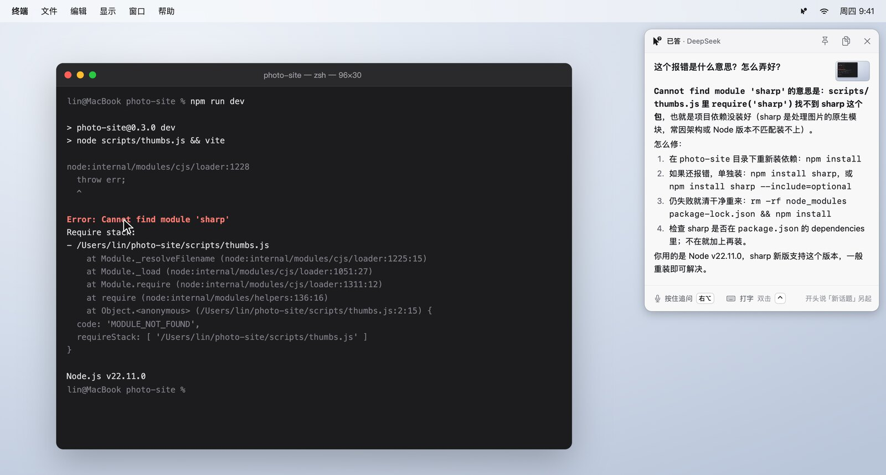
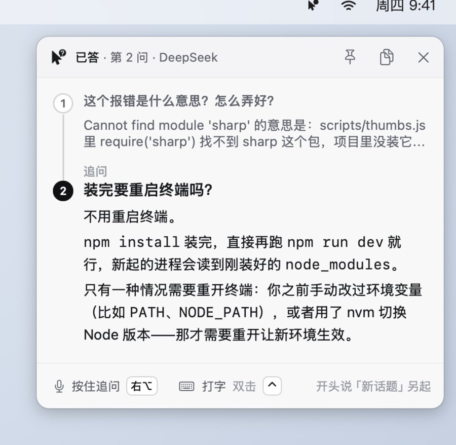
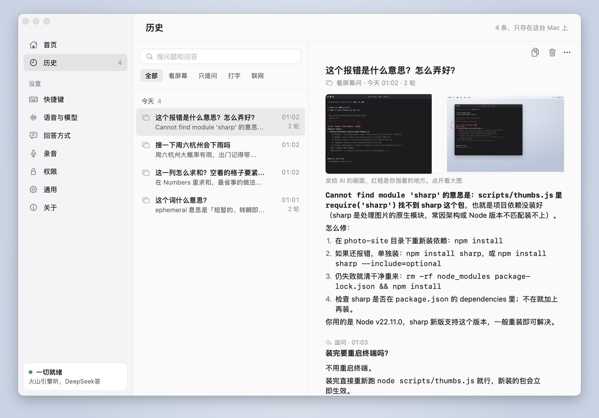
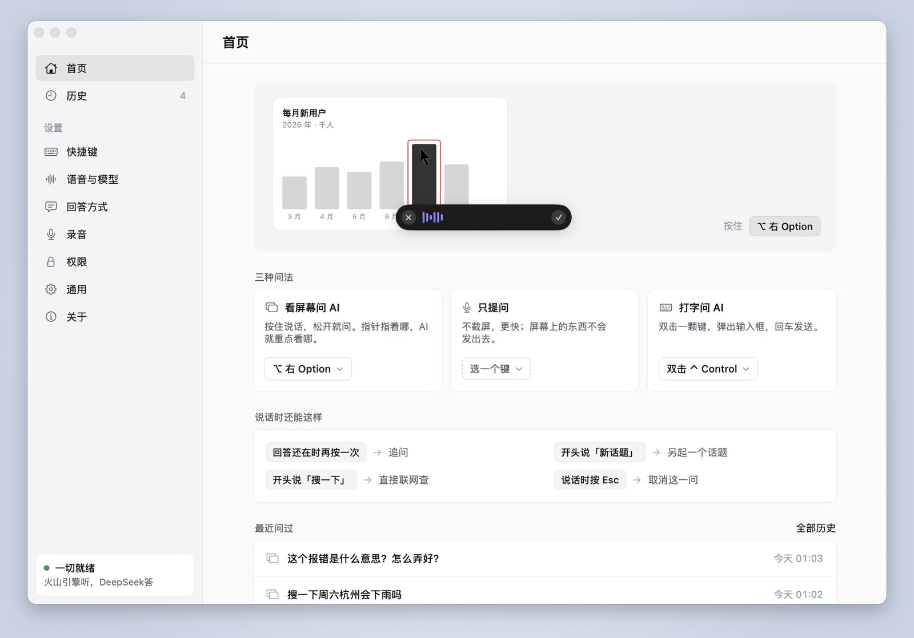

<p align="center"></p>

<h1 align="center">Ask Free</h1>

<p align="center"><b>按一个键说出问题，AI 看着你的屏幕回答。</b></p>

<p align="center"><a href="https://github.com/SchaeferAnjon/askfree/releases/latest/download/AskFree.dmg"><b>下载 Mac 版（Apple 芯片和 Intel 通用）</b></a></p>

<p align="center"><a href="https://askfree.us-cloud.uk/"></a></p>

<p align="center">
<a href="https://github.com/SchaeferAnjon/askfree/releases/latest"></a>
<a href="LICENSE"></a>


</p>

<p align="center"><sub><a href="README.md">English</a> · <b>简体中文</b></sub></p>

<p align="center"></p>

## 它做什么

看网页、读论文、写代码、填表格时碰到不懂的，鼠标指着它，按住提问键问一句「这是什么意思」，松开键，回答就出现在屏幕右上角。不用切窗口，不用自己截图，也不用打字。macOS 菜单栏应用，开源。用法二选一：会员不用填任何 Key，前 100 位新用户免费问 30 个问题；也可以用你自己的 API Key，永久免费。

- **看着屏幕回答**：按键那一刻截下整个屏幕和指针所在的窗口，连同你的问题一起发给 AI。
- **指哪看哪**：指针停的地方标一个红框。问「这个词」「这个按钮」就答框里那一样，问「这页讲什么」就看整页。
- **追问接着话题**：回答还在时再按一次提问键就是追问，带着前面的问答；开头说「新话题」另起一个。
- **自己联网**：问最新的消息、价格、汇率时自己去查；开头说「搜一下」直接联网。
- **回答里给图**：说「找个照片我看一下」，回答下面放 3 张网上的图，点开看原图。
- **历史留截图**：每轮问答连同当时发给 AI 的截图都存在本机，按天列出，能搜、复制、删除。
- **打字问**：不方便出声时双击一个键（比如 Control），截下当前屏幕，打字提问。

<details>
<summary>能用哪些语言提问</summary>

- **说话问**：火山引擎[录音文件识别文档](https://www.volcengine.com/docs/6561/1354868)写着，不指定语种时（Ask Free 不指定）能认中文普通话和英语，以及粤语、上海话、闽南语、四川话、陕西话。日语、韩语等其他语种要在请求里指定语种才认，Ask Free 目前不指定。文档没单独写中英混说。这一条是按文档写的（2026 年 10 月 27 日查），没有实测。
- **打字问**：不经过语音识别，DeepSeek 和千问读得懂的语言都能问。
- **回答**跟着提问的语言走：用英文问就用英文答。1.2.0 起问题不是中文时，提示词最后会点名用哪种语言答（2026 年 10 月 28 日用 DeepSeek 实测 5 个英文问题，都用英文答）。
- 软件界面只有中文。

</details>

## 怎么用

<p align="center"></p>

快捷键默认不设，每台键盘不一样：第一次打开时在欢迎引导里选一个（右 Option、右 Command、fn、Control，或者自己录一个键），之后在主窗口「快捷键」页改。

| 问法 | 怎么按 | 看不看屏幕 |
|---|---|---|
| **看屏幕问 AI** | 按住提问键说话，松开就问；或轻点一下开始、再点一下结束 | 看，按下那一刻鼠标指在哪，AI 就重点看哪 |
| **只提问** | 在「快捷键」页另设一个键，按法一样 | 不看，更快 |
| **打字问** | 在「快捷键」页选一个双击键（比如双击 Control），双击后打字 | 看，截下当前屏幕 |

回答显示在屏幕右上角的面板里：

- 回答还在时再按提问键 → 追问（带着这个话题的上下文）
- 开头说「新话题」→ 另起一个话题
- 开头说「搜一下」→ 直接联网查
- 说话时按 Esc → 取消

**历史**：主窗口「历史」页（或菜单栏「历史记录」）按天列出问过的话题，点开看每一轮问答和当时的截图，可搜索、复制、右键删除、清空。

## 真机截图

<table>
<tr>
<td colspan="2" align="center"><picture><source media="(prefers-color-scheme: dark)" srcset="docs/readme/zh/answer-dark.jpg"></picture><br><sub>看屏幕回答</sub></td>
</tr>
<tr>
<td align="center"><picture><source media="(prefers-color-scheme: dark)" srcset="docs/readme/zh/followup-dark.jpg"></picture><br><sub>追问</sub></td>
<td align="center"><picture><source media="(prefers-color-scheme: dark)" srcset="docs/readme/zh/history-dark.jpg"></picture><br><sub>历史</sub></td>
</tr>
<tr>
<td colspan="2" align="center"><picture><source media="(prefers-color-scheme: dark)" srcset="docs/readme/zh/home-dark.jpg"></picture><br><sub>主窗口首页</sub></td>
</tr>
</table>

## 需要准备

1. 一台 Mac，Apple 芯片和 Intel 芯片都行，macOS 14 或更新。
2. 选一种用法，在欢迎引导的「用法」那一步选，之后在主窗口「会员」页随时能换：
   - **会员**：不用填任何 Key。语音识别、回答和联网都经我们的服务器转发，详见下面「会员」一节。
   - **自带 Key**：永久免费，不经过我们。要两个 API Key，在欢迎引导或主窗口「语音与模型」页填。去哪拿、怎么填，[官网配置教程](https://askfree.us-cloud.uk/#page=setup)一步步讲。
     - **语音识别**：火山引擎（豆包）录音文件识别，[控制台](https://console.volcengine.com/speech/app)。每个识别版本送 20 小时免费额度，半年有效。
     - **问答模型**：DeepSeek（出字最快，需要时自己联网，[控制台](https://platform.deepseek.com/api_keys)）或阿里百炼千问（自带联网搜索，[控制台](https://bailian.console.aliyun.com/)，每个模型送 100 万 Token，开通后 90 天内有效）。
     - 识别和回答按服务商的价格从你自己的账户扣，以各家的价格页为准：[火山引擎](https://www.volcengine.com/docs/6561/1359370)、[DeepSeek](https://api-docs.deepseek.com/zh-cn/quick_start/pricing)、[阿里百炼](https://help.aliyun.com/zh/model-studio/model-pricing)。
3. 三项系统权限：麦克风、辅助功能（全局快捷键）、屏幕录制（看屏幕问）。

## 会员

- **免费试用**：前 100 位新用户每台 Mac 免费问 30 个问题，不过期。第一次用会员提问、打开「会员」页或在引导里点「领取免费试用」时才领。
- **订阅**：每月 ¥9.9 或 $1.99，每年 ¥99 或 $19.9。Stripe 自动续费，随时取消，用到这一期结束。
- **微信一次买**：人民币用户也能一次买 1 个月 ¥9.9 或 1 年 ¥99，不自动续费，从现在的到期日往后接着算。
- **每天 200 个问题**，北京时间早上 8 点重置。一个问题里的识别、回答、联网和 15 分钟内的重试只算一个。
- **两台 Mac**：买了以后发一个授权码，在另一台的「会员」页输入就行，一个授权码最多用在 2 台 Mac 上。
- **管理订阅**（换卡、改月付年付、取消、看发票）：主窗口「会员」页点「管理订阅」。没装 Ask Free 或换了电脑，打开 [管理订阅的登录页](https://billing.stripe.com/p/login/28EaEQ7Ia9ir3ohabR2Nq00)，填付款时的邮箱，收一封登录信。
- **自带 Key 永久免费**，不限次数，会员和自带 Key 随时能换。

## 安装

| | 下载 | 系统 |
|---|---|---|
| **Mac**（Apple 芯片和 Intel 芯片通用） | [AskFree.dmg](https://github.com/SchaeferAnjon/askfree/releases/latest/download/AskFree.dmg)（最新版） | macOS 14 或更新 |

打开下载好的 `AskFree.dmg`，把 **Ask Free** 拖到旁边的「应用程序」文件夹，再从「应用程序」里打开。别在 dmg 窗口或「下载」文件夹里直接打开：那样 macOS 会从一个临时的只读位置运行它，给过的权限下次就不认了。

**自动更新**：从 1.2.0 起，Ask Free 每 6 小时到 GitHub 查一次新版本，有新版就在后台下好、核对签名，在菜单栏和主窗口「通用 → 更新」里给「重启更新」；不点的话，下次退出时装上。在「通用 → 更新」能关掉。1.1.0 和更早的版本没有自动更新，要手动下载一次 1.2.0。旧版本和每一版的更新说明在 [Releases 页面](https://github.com/SchaeferAnjon/askfree/releases)。

<details>
<summary>第一次打开</summary>

- **提示「Apple 无法验证“Ask Free”是否包含……恶意软件」**（macOS 14 上是「Apple 无法检查其是否包含恶意软件」）：Ask Free 有 Developer ID 签名，没有经过苹果公证。打开 **系统设置** 里的 **隐私与安全性**，拉到最下面点 **仍要打开**。
- **欢迎引导**：欢迎、授权、选用法（会员或自带 Key）、提问键、匿名统计（同意或不用了），最后真问一句，确认都通了。选自带 Key 的，中间多两步填语音识别和问答模型的 Key。大约 3 分钟。

<p align="center"> </p>

- **授权**：麦克风在系统弹框里点 **允许**；辅助功能和屏幕录制点 **打开系统设置**，系统设置旁边会浮出 Ask Free 的图标，往左拖进列表就打开了。屏幕录制拖进去以后，系统会请你退出并重新打开 Ask Free，重开后引导回到这一步。
- **从 1.0.1 升级**：系统可能要你重新给辅助功能和屏幕录制权限。在主窗口 **权限** 页点 **打开系统设置**，把图标拖进列表。

</details>

## 隐私

- 不用注册，没有账号。
- **自带 Key 时**，你的问题、录音和截图只直连你选的服务商，不经过我们：
  - 你说的话：录音直接发给火山引擎识别成文字，录音不保存。
  - 问题和截图：发给你选的问答模型，DeepSeek 或阿里百炼。
  - 要联网时，搜索词发给同一家：DeepSeek 的搜索接口，或千问自带的联网搜索。
- **用会员时**，录音、问题文字和截图发到我们的服务器（api.us-cloud.uk），服务器转给火山引擎（语音识别）和 DeepSeek（回答、联网搜索），拿到结果就回给你。服务器不存录音、截图、问题和回答，只记每个问题用了多少（算不算一次、token 数、识别时长、联网次数）。
  - 第一次领试用时发一个设备标识：这台 Mac 的硬件编号加软件名算出的哈希，服务器再加盐哈希后存；还发平台、芯片和版本号，服务器只存平台。服务器记下网络段（IPv4 /24、IPv6 /48），用来限制同一个网络一天领试用的台数，不存完整 IP。
  - 付款由 Stripe 处理，我们拿不到卡号。Stripe 告诉我们付款邮箱、Stripe 客户编号和订阅状态，用来发授权码、算会员到哪天。
- 只在你按下提问键（或双击打字键）那一刻截屏，截整个屏幕的缩小图和指针所在窗口的清晰图。「只提问」键不截；在「回答方式」页关掉「让 AI 看屏幕」也不截。
- 「联网的回答附上图」默认开着：要配图时，把一个找图用的搜索词（没有就用你的问题）发给 DuckDuckGo，不含截图和录音。在「回答方式」页能关。
- 检查更新：每 6 小时向 GitHub 取一次新版本信息，有新版就下载安装包，不带你的问题、录音、截图和 Key。在「通用 → 更新」能关。
- 匿名使用统计：我们会给前 100 位用户免费额度，所以需要统计有多少人在用。统计是匿名的。第一次打开时问你，**你同意了才发**，每天一次，发给我们的服务器（api.us-cloud.uk）：一个随机编号（是第一次发送时随机生成的，跟名字、邮箱、电脑硬件都没关系）、是哪个软件、版本号、系统和芯片类型、用会员还是自带 Key、界面语言。不发你问的话、回答、录音、截图和 Key。在主窗口「通用 → 匿名使用统计」随时能改。
- Key 和会员凭据存在系统钥匙串里。问答历史和截图只存在本机 `~/.config/askfree/`，只有你的账户能读：文字在 `history.jsonl`，发给模型的截图和找到的图的缩略图在 `history-images/`，在「历史」页能删单条或清空。

完整的说明在官网的[隐私说明](https://askfree.us-cloud.uk/#page=privacy)。

## 从源码编译

用 Xcode 26.3 编译通过（更早的版本没试过）。

```bash
bash scripts/install_app.sh   # 编译并安装到 /Applications/Ask Free.app
bash build.sh                 # 只编译，产物在 dist/Ask Free.app
bash scripts/dev_run.sh       # 编译并启动开发版 Ask Free Dev（独立配置，不影响正式版）
```

工程由 [XcodeGen](https://github.com/yonaskolb/XcodeGen) 从 `project.yml` 生成。增删源文件后运行 `xcodegen generate`（`build.sh` 检测到 xcodegen 时会自动运行）。

核心逻辑在 Swift Package `AskFreeCore` 里，单元测试：

```bash
cd AskFreeCore && swift test
```

## 目录

```
Sources/        App 界面：菜单栏、录音胶囊、回答面板、主窗口（首页、历史、各项设置）、欢迎引导
AskFreeCore/    核心逻辑：语音识别、问答与联网、快捷键状态机、配置与钥匙串
Resources/      图标与 entitlements
scripts/        安装与开发脚本
```

## 致谢与许可

Ask Free 基于 [Typefree](https://github.com/kdsz001/typefree)（作者 kdsz001）的「问 AI」功能修改而来，去掉了听写、润色、词库和上游的会员等部分，只保留语音提问。现在的会员和自动更新是另外做的，自动更新用的是 [Sparkle](https://sparkle-project.org)。

以 [GPL-3.0](LICENSE) 发布，与上游一致。
