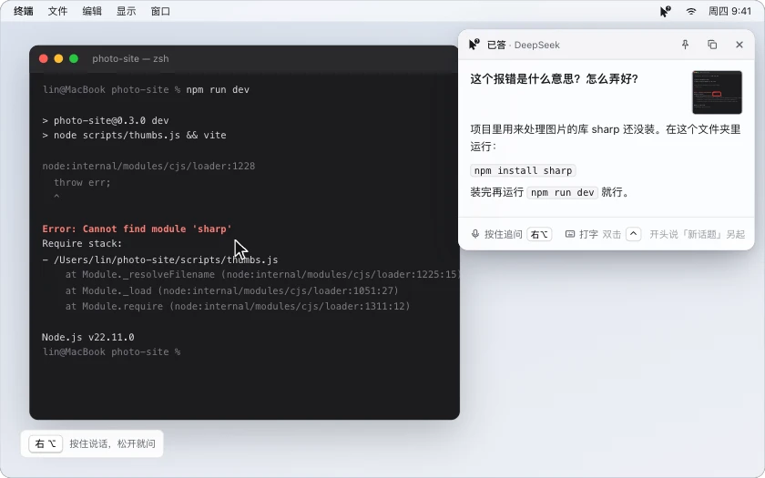
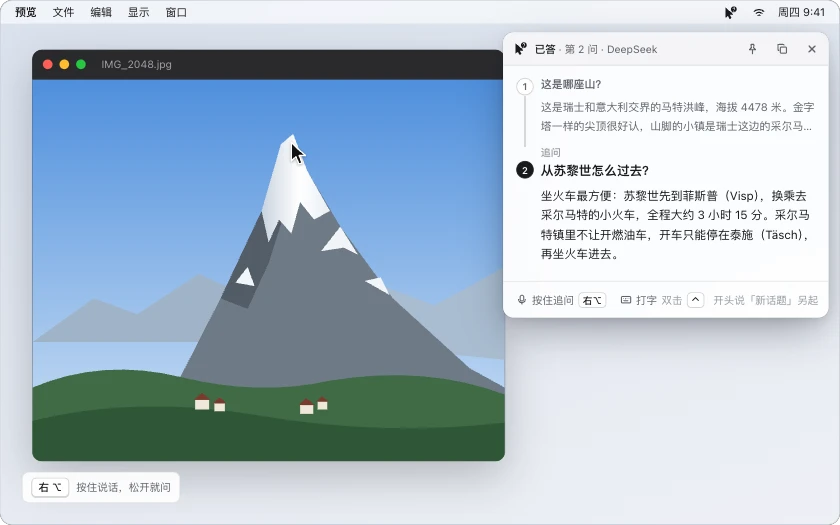

<p align="center"></p>

<h1 align="center">Ask Free</h1>

<p align="center"><b>按一个键说出问题，AI 看着你的屏幕回答。</b></p>

<p align="center"><a href="https://github.com/SchaeferAnjon/askfree/releases/latest"><b>下载 Mac 版（Apple 芯片）</b></a></p>

<p align="center"><a href="https://askfree.us-cloud.uk/"></a></p>

<p align="center">
<a href="https://github.com/SchaeferAnjon/askfree/releases/latest"></a>
<a href="LICENSE"></a>


</p>

<p align="center"><sub><a href="README.md">English</a> · <b>简体中文</b></sub></p>

<!-- 首屏动图（README 第 30 条）放这里，840 宽的 WebP，例如：
<p align="center"></p>
-->

## 它做什么

看网页、读论文、写代码、填表格时碰到不懂的，鼠标指着它，按住提问键问一句「这是什么意思」，松开键，回答就出现在屏幕右上角。不用切窗口，不用自己截图，也不用打字。macOS 菜单栏应用，用你自己的 API Key，开源免费。

- **看着屏幕回答**：按键那一刻截下整个屏幕和指针所在的窗口，连同你的问题一起发给 AI。
- **指哪看哪**：指针停的地方标一个红框。问「这个词」「这个按钮」就答框里那一样，问「这页讲什么」就看整页。
- **追问接着话题**：回答还在时再按一次提问键就是追问，带着前面的问答；开头说「新话题」另起一个。
- **自己联网**：问最新的消息、价格、汇率时自己去查；开头说「搜一下」直接联网。
- **回答里给图**：说「找个照片我看一下」，回答下面放 3 张网上的图，点开看原图。
- **历史留截图**：每轮问答连同当时发给 AI 的截图都存在本机，按天列出，能搜、复制、删除。
- **打字问**：不方便出声时双击一个键（比如 Control），截下当前屏幕，打字提问。

<details>
<summary>能用哪些语言提问</summary>

- **说话问**：火山引擎[录音文件识别文档](https://www.volcengine.com/docs/6561/1354868)写着，不指定语种时（Ask Free 不指定）能认中文普通话和英语，以及粤语、上海话、闽南语、四川话、陕西话。日语、韩语等其他语种要在请求里指定语种才认，Ask Free 目前不指定。文档没单独写中英混说。这一条是按文档写的（2026 年 10 月 27 日查），没有实测。
- **打字问**：不经过语音识别，DeepSeek 和千问读得懂的语言都能问。
- **回答**跟着提问的语言走：用英文问就用英文答。
- 软件界面只有中文。

</details>

## 怎么用

<!-- 功能小节动图（README 第 30 条）放这里，例如追问和联网：
<p align="center"></p>
-->

快捷键默认不设，每台键盘不一样：第一次打开时在欢迎引导里选一个（右 Option、右 Command、fn、Control，或者自己录一个键），之后在主窗口「快捷键」页改。

| 问法 | 怎么按 | 看不看屏幕 |
|---|---|---|
| **看屏幕问 AI** | 按住提问键说话，松开就问；或轻点一下开始、再点一下结束 | 看，按下那一刻鼠标指在哪，AI 就重点看哪 |
| **只提问** | 在「快捷键」页另设一个键，按法一样 | 不看，更快 |
| **打字问** | 在「快捷键」页选一个双击键（比如双击 Control），双击后打字 | 看，截下当前屏幕 |

回答显示在屏幕右上角的面板里：

- 回答还在时再按提问键 → 追问（带着这个话题的上下文）
- 开头说「新话题」→ 另起一个话题
- 开头说「搜一下」→ 直接联网查
- 说话时按 Esc → 取消

**历史**：主窗口「历史」页（或菜单栏「历史记录」）按天列出问过的话题，点开看每一轮问答和当时的截图，可搜索、复制、右键删除、清空。

<!-- 真机截图（README 第 31 条）放这里，照 MeetCaption README 的「真机截图」表：
## 真机截图

<table>
<tr>
<td colspan="2" align="center"><br><sub>看屏幕回答</sub></td>
</tr>
<tr>
<td align="center"><br><sub>追问</sub></td>
<td align="center"><picture><source media="(prefers-color-scheme: dark)" srcset="docs/readme/shots/history-dark.jpg"></picture><br><sub>历史</sub></td>
</tr>
</table>
-->

## 需要准备

1. 一台 Apple 芯片的 Mac，macOS 14 或更新。
2. 两个 API Key，在欢迎引导或主窗口「语音与模型」页填。去哪拿、怎么填，[官网配置教程](https://askfree.us-cloud.uk/#page=setup)一步步讲。
   - **语音识别**：火山引擎（豆包）录音文件识别，[控制台](https://console.volcengine.com/speech/app)。每个识别版本送 20 小时免费额度，半年有效。
   - **问答模型**：DeepSeek（出字最快，需要时自己联网，[控制台](https://platform.deepseek.com/api_keys)）或阿里百炼千问（自带联网搜索，[控制台](https://bailian.console.aliyun.com/)，每个模型送 100 万 Token，开通后 90 天内有效）。
3. 三项系统权限：麦克风、辅助功能（全局快捷键）、屏幕录制（看屏幕问）。

软件不收钱，识别和回答按服务商的价格从你自己的账户扣。免费额度用完以后，一次看屏幕的语音提问大约 1 到 2.5 分钱，每天问 20 次，一个月大约 6 到 15 元。

<details>
<summary>一次提问的钱是怎么算的</summary>

按 2026 年 10 月 27 日查的各家官网价格估算，单位人民币。用量取自开发版日志里 9 次看屏幕的语音提问：录音 2.4 到 25 秒，一半在 4.5 秒以内；回答 58 到 316 字。日志不记 Token 数，下面的 Token 按字数和截图尺寸折算。

| 哪一项 | 每次大约 | 怎么算的 |
|---|---|---|
| 语音识别：火山引擎极速版（默认） | 0.006 到 0.013 元 | 一句 5 到 10 秒，[后付费 4.5 元/小时](https://www.volcengine.com/docs/6561/1359370)；标准版 2.3 元/小时 |
| 看屏幕回答：DeepSeek（deepseek-flash） | 0.004 到 0.011 元 | 输入约 3,000 Token（两张截图最多 2,048，提示词约 800），输出 200 到 600 Token。[北京时间工作日 9–12 点、14–18 点](https://api-docs.deepseek.com/zh-cn/quick_start/pricing)输入 2 元、输出 8 元每百万 Token，其余时间减半 |
| 看屏幕回答：千问（qwen3.8-flash） | 约 0.004 元 | 输入约 3,300 Token（两张截图约 2,500），输出最多 600 Token；[输入 0.8 元、输出 2.7 元每百万 Token](https://help.aliyun.com/zh/model-studio/model-pricing) |
| 联网查一次（AI 觉得要查，或你说「搜一下」） | 另加 0.005 到 0.01 元 | DeepSeek 搜索 5 元/千次，6 条结果再多约 2,500 Token 输入；千问联网搜索 3 元/千次，网页内容也算输入 Token |

合计一次看屏幕提问 0.01 到 0.025 元，一半以上是语音识别。追问和「只提问」不带截图，更便宜；打字问不花识别的钱。价格会变，以各家页面为准。

</details>

## 安装

| | 下载 | 系统 |
|---|---|---|
| **Apple 芯片的 Mac**（M1 及以后） | [Releases 页面](https://github.com/SchaeferAnjon/askfree/releases/latest)里的 `AskFree-<版本号>.zip` | macOS 14 或更新 |

Intel 芯片的 Mac 用不了。下载后解压，把 `Ask Free.app` 拖进「应用程序」，再从「应用程序」里打开；直接在「下载」文件夹里打开，macOS 会从一个临时的只读位置运行它。

旧版本也在 [Releases 页面](https://github.com/SchaeferAnjon/askfree/releases)。Ask Free 目前不会自动更新，新版本发在同一个页面。

<details>
<summary>第一次打开</summary>

- **提示无法验证开发者**：这一版有 Developer ID 签名，还没经过苹果公证。打开 **系统设置** 里的 **隐私与安全性**，拉到最下面点 **仍要打开**。
- **欢迎引导**一共六步：欢迎、授权、语音识别、问答模型、提问键，最后真问一句，确认都通了，大约 3 分钟。
- **授权**：麦克风在系统弹框里点 **允许**；辅助功能和屏幕录制点 **打开系统设置**，系统设置旁边会浮出 Ask Free 的图标，往左拖进列表就打开了。屏幕录制拖进去以后，系统会请你退出并重新打开 Ask Free，重开后引导回到这一步。
- **从 1.0.1 升级**：系统可能要你重新给辅助功能和屏幕录制权限。在主窗口 **权限** 页点 **打开系统设置**，把图标拖进列表。

</details>

## 隐私

- 不用注册，没有账号，也没有我们自己的服务器：Ask Free 只直连你选的服务商。
- 你说的话：录音直接发给火山引擎识别成文字，录音不保存。
- 问题和截图：发给你选的问答模型，DeepSeek 或阿里百炼。
- 只在你按下提问键（或双击打字键）那一刻截屏，截整个屏幕的缩小图和指针所在窗口的清晰图。「只提问」键不截；在「回答方式」页关掉「让 AI 看屏幕」也不截。
- 要联网时，搜索词发给同一家：DeepSeek 的搜索接口，或千问自带的联网搜索。
- 「联网的回答附上图」默认开着：要配图时，把一个找图用的搜索词（没有就用你的问题）发给 DuckDuckGo，不含截图和录音。在「回答方式」页能关。
- Key 存在系统钥匙串里。问答历史和截图只存在本机 `~/.config/askfree/`，只有你的账户能读：文字在 `history.jsonl`，发给模型的截图和找到的图的缩略图在 `history-images/`，在「历史」页能删单条或清空。

## 从源码编译

用 Xcode 26.3 编译通过（更早的版本没试过）。

```bash
bash scripts/install_app.sh   # 编译并安装到 /Applications/Ask Free.app
bash build.sh                 # 只编译，产物在 dist/Ask Free.app
bash scripts/dev_run.sh       # 编译并启动开发版 Ask Free Dev（独立配置，不影响正式版）
```

工程由 [XcodeGen](https://github.com/yonaskolb/XcodeGen) 从 `project.yml` 生成。增删源文件后运行 `xcodegen generate`（`build.sh` 检测到 xcodegen 时会自动运行）。

核心逻辑在 Swift Package `AskFreeCore` 里，单元测试：

```bash
cd AskFreeCore && swift test
```

## 目录

```
Sources/        App 界面：菜单栏、录音胶囊、回答面板、主窗口（首页、历史、各项设置）、欢迎引导
AskFreeCore/    核心逻辑：语音识别、问答与联网、快捷键状态机、配置与钥匙串
Resources/      图标与 entitlements
scripts/        安装与开发脚本
```

## 致谢与许可

Ask Free 基于 [Typefree](https://github.com/kdsz001/typefree)（作者 kdsz001）的「问 AI」功能修改而来，去掉了听写、润色、词库、会员与自动更新等部分，只保留语音提问。

以 [GPL-3.0](LICENSE) 发布，与上游一致。
