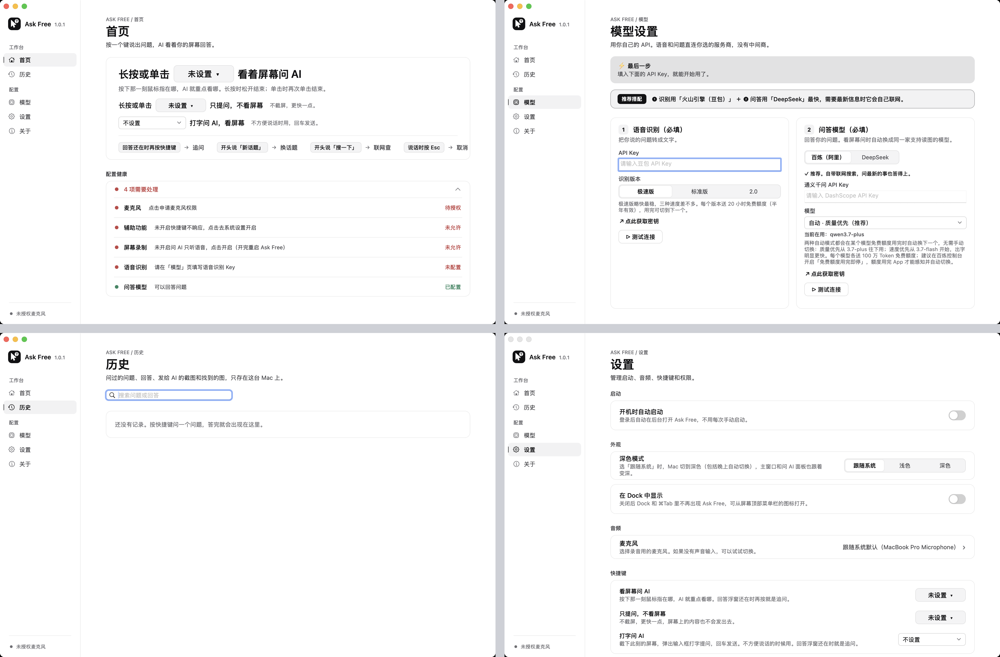

# Ask Free 主窗口重做：和 GetNewWord 新版同一家族

- 新用户一打开就是「开始」三步：填两个 Key、允许三项权限、选一个提问键。当前那步是全页唯一的黑按钮，做完打勾；辅助功能和屏幕录制在原型里真能把图标拖进系统设置的列表。
- 模型页改成一条「你说的话 → 听成文字 → 回答 → 右上角」的链路，加两组服务商单选，只展开选中的那家；那段讲自动换模型的长说明收进「自动是怎么换的」。
- 历史能搜（问题和回答一起搜，命中处高亮）、按问法筛、按天分组、右键删除、上下键翻，截图点开看大图，找到的图和追问都在详情里。
- 两个方向结构不同：A「单窗侧栏」一个窗口一列侧栏，放下开始、历史和七页设置；B「问答书房」照 GetNewWord 分两个窗口，主窗口就是历史三栏，设置用 ⌘, 另开。我推荐 A。
- 主色用 Ask Free 图标里的墨黑，不用系统蓝；开关是方角的，选中是灰底，和 GetNewWord 同一套，只是把它的靛蓝换成墨黑。

## Diagnosis

现在主窗口的四页，开发版截的（还没填语音 Key、没授权麦克风）：左上首页、右上模型、左下历史、右下设置。

1. 首页最大的一块是三行快捷键，三行都写「未设置」，还用了两种样子的下拉；四个手势提示挤在卡片底边。新用户看不出先设哪一个。
2. 真正挡住提问的四件事（麦克风、辅助功能、屏幕录制、语音 Key）放在页面最下面的「配置健康」，五行红字一样重，没有先后。
3. 每页顶上都是一行大写加宽的「ASK FREE / 首页」、一个大标题、一句说明，五页都一样，占掉窗口顶上一大块。
4. 侧栏底部只说「未授权麦克风」，另外三件没做的事没提。
5. 模型页填 Key 之前要先读两条横幅：「最后一步」和「推荐搭配」，推荐搭配又把下面两张卡说了一遍。
6. 选服务商是两个名字的分段按钮，看不出哪家快、哪家能联网、两家能不能共用 Key；推荐理由藏在选中后的一行小字里。
7. 右卡一整段讲自动模式怎么换模型，左右两卡一高一矮，左卡下面空一大块。
8. 历史没记录时只有框里一行字；有记录时（按代码看）每条在原地展开，看下一条要先收起，截图和找到的图也只在展开里。
9. 设置是一条长页：启动、外观、音频、快捷键、回答方式、录音浮窗、权限往下排，每项一张卡加两行说明，权限在最底下。
10. 开关是胶囊形，不是方角开关。
11. 左侧栏加几页的骨架能留着用：A 沿用它，B 把它分给历史和设置两个窗口。

关于页截图上没有问题，只是一张大卡片里居中几行字；两个方向都把它并进设置侧栏，加上「你的数据存在哪」。

## Direction A: 单窗侧栏

一个窗口、一列侧栏：「开始」（配好后变「首页」）、「历史」，下面七页设置；侧栏和 GetNewWord 新设置页同一种，每页顶上一块会动的示意。

### A1 第一次打开

- 侧栏第一行「开始」挂橙点，没做完的设置页也挂橙点；底部状态卡写「还差 3 步」和是哪三件。
- 顶上一块演示：指针移到图表最高那根，细红框框住，底部录音浮窗，右上角弹出回答。下面三步，当前那步浅灰底、黑按钮，做完打勾变灰。
- 第 1 步「去填写」跳到「语音与模型」；两个 Key 都验证过，页顶出现「回到第一步那页」。
- 第 2 步原地做：麦克风点「允许」弹系统框；辅助功能、屏幕录制点「打开系统设置」，右边浮出 Ask Free 图标，往左拖进列表就开了。
- 第 3 步原地选键：Fn、右 Command 等，没有默认键；「自定义组合键…」能真按。
- 三步做完，标题变「都好了，问一个试试」；点「看一遍演示」或随便按个键，演示放一遍，第一条问答存进历史，「开始」变成「首页」。

### A2 首页和历史

- 首页：演示、三种问法（每张卡带它的键，点了就能改）、说话时的四个手势、最近问过的三条。
- 历史分两栏：左边搜索框和「全部 / 看屏幕 / 只提问 / 打字 / 联网」，按天分组，每行是问题、回答第一句、时间和几轮；右边是整段问答：发给 AI 的截图（红框是你指着的地方，点开看大图）、回答、找到的图、追问。
- 右上三个图标：复制、删除（问一次）、更多；列表行能右键；上下方向键换一条。

### A3 设置七页

- 快捷键：三种问法各一行，键帽点开选键；下面是「说话时还能这样」。
- 语音与模型：顶上的链路里填好的那家打勾、连线开始流动；下面「听懂你说的话」「回答你的问题」两组单选，只展开选中的那家：Key、验证、去哪拿 Key、版本或模型。两边都选阿里时，回答那家写「用上面那个 Key」。
- 回答方式：上面是回答面板的样子，开关「让 AI 看屏幕」「附上图」「先想一想」，面板跟着变；读图模型收进「高级」。
- 录音：浮窗彩色和墨黑两张卡，两边按钮的开关，麦克风一行带跳动的音量格。
- 权限：一张拖图标的动图，三行状态。通用：开机启动、Dock、外观三张缩略图（点「深色」整个原型换深色）。关于：图标、版本、开源许可、源码、你的数据在哪。

## Direction B: 问答书房

照 GetNewWord 的两个窗口：主窗口就是历史三栏（侧栏筛选、列表、详情），设置是 ⌘, 打开的另一个窗口，七页内容和 A 一样。

### B1 第一次打开

- 主窗口的列表和详情合成一页「开始用 Ask Free」，三步和 A 一样；侧栏的筛选先是灰的。
- 第 1 步「去填写」打开设置窗口的「语音与模型」，叠在主窗口前面；填完点「回到第一步那页」，主窗口回到前面。
- 三步做完试一次，第一条问答落进列表并选中，主窗口从此就是历史。

### B2 历史三栏

- 侧栏按问法和带了什么筛：全部问答、看屏幕问、只提问、打字问、联网查过、有截图，每行带数量；最底下是状态卡和「设置 ⌘,」。
- 工具栏一直写着「按住 右 Command 提问」，点了打开快捷键设置；旁边是搜索框。
- 列表和详情的内容和 A 一样，列表宽一点。

### B3 设置窗口

- 和 GetNewWord 设置一样的独立窗口，七页和 A 一样；点后面的主窗口，它就退到后面。
- 菜单栏图标的菜单里，「打开主窗口」「历史记录」「设置…」分别把对应的窗口叫到前面。

## 两个方向都有的

- 还差什么只说一套话：开始页的三步、侧栏的橙点、状态卡说的是同一件事，做完一处，三处一起变。
- 一屏最多一个黑色实心按钮，给当前那一步；别的按钮都是白底细边。
- 提问键没有默认值，菜单里标出另一个问法在用的键；选了别人在用的，那一个改成不设置并提示。
- 历史的详情顺序固定：截图、回答、找到的图、追问；列表、截图、菜单栏图标都有右键或下拉。
- 原型右上角菜单栏里 Ask Free 的图标能点，菜单列出三种问法的键和几个入口。

## 和另外三块对齐的东西

- 主色：图标里指针的墨黑。浅色是黑底白字，深色是白底黑字；只给实心按钮、开着的开关、选中的单选。不用系统蓝，也不用 GetNewWord 的靛蓝。
- 唯一固定的红：截图上标指针的细红框，只出现在截图里，不当主色。
- 灰阶、状态色（绿：已允许、能用；橙：还差一步；红：出错、删除）、字体（系统字体加苹方）、圆角和图标线宽都照 GetNewWord 新版。
- 开关一律方角；授权一律拖图标，麦克风用系统弹框；图标用现在的「指针加问号」，菜单栏用它的单色剪影。

## 替你定了的事

- 侧栏去掉「工作台 / 配置」两个组名；原来的「设置」一页拆成快捷键、回答方式、录音、权限、通用五页，「模型」改叫「语音与模型」。
- 页头只留页名，去掉「ASK FREE / 首页」和每页那句说明。
- 「配置健康」不再单列，拆进三步和状态卡。
- 麦克风选择从「音频」挪进「录音」，和浮窗样子放在一页。
- 演示里的图表和问题、历史里的 13 条问答都是编的示意，没读你机器上的真历史。

## 跟了哪些偏好

- 跟了：Ask Free 和 GetNewWord 同家族、设置页侧栏图解（两个方向的设置都用它）、主窗口三栏书房（B 照它）、拖图标授权和授权图标从右往左拖、快捷键默认不设、历史存截图和图、指针问号图标、指针标记不画圆心、方角开关、列表要右键菜单、启动就要权限（三项权限都在第一页做完）、卡片别贴边、配色方案要真不同和换色不算重设计（A、B 结构不同）、汇报界面别报数字、用户点名的交付格式。
- 冲突一：askfree 里还有一条「沿用原界面」（精简时不重做界面），和今天选的「同家族」相反；我按今天这条。
- 冲突二：「AI 多家可选」（会议字幕那边）要列很多家服务商；Ask Free 现在的代码听写只接了火山和阿里、回答只接了 DeepSeek 和千问，原型只画这几家，加别家要先改代码。

## 界面标准

项目根目录还没有 `DESIGN.md`，诊断里的判断按通用设计原则下的，你确认标准之前都算暂定。这个文件夹里已经有一份 `DESIGN.draft.md`（不是我写的），我的原型和它一致：墨黑主色、侧栏宽度、页名大小、方角开关、拖图标授权。它还缺两条，确认时一起补：每页顶上示意图的规格（循环播放、不撑开布局），和历史详情的固定顺序。

## Not done

- 原型里填 Key、验证、授权、录音、演示都是模拟的，按固定时间变成成功；拖图标只认拖进列表那一下。
- 现状只截了还没配置时的五页；有历史、有 Key 时的样子没截，按代码看的。
- 豆包回答（现在藏着的选项）、窗口变窄和侧栏收起的样子没画。
- 回答面板、录音浮窗、打字问的输入框归「提问浮层」那一块，这里只当示意；菜单栏菜单归「欢迎引导和菜单栏」那一块，这里只画了能点的样子。
- 关于页没有检查更新：Ask Free 去掉了自动更新。
- 原型只有中文。
- 没改代码，没提交。

## Recommendation

我推荐 A：Ask Free 只有一种内容（问答），历史加七页设置一个窗口装得下，第一次配置、改设置、翻历史都在同一列侧栏里，不用在两个窗口之间找；现在本来就是一个窗口加侧栏，改起来是在原来的骨架上换内容。B 和 GetNewWord 一模一样、历史更像主角，适合问得多、常回头翻的人，但第一次配置要在主窗口和设置窗口之间来回；如果你喜欢 B 工具栏上那句「按住 右 Command 提问」，可以搬进 A 的历史页。

| | A 单窗侧栏 | B 问答书房 |
|---|---|---|
| 窗口 | 一个，侧栏九行 | 两个：历史主窗口加设置窗口 |
| 新用户第一眼 | 「开始」三步，侧栏和状态卡同步标出 | 主窗口里同样的三步，填 Key 时弹出设置窗口 |
| 配好以后打开 | 首页：演示、三种问法、最近问过 | 直接是历史 |
| 翻历史 | 内容区两栏，筛选在列表上方 | 三栏，筛选在侧栏，列表更宽 |
| 改设置 | 侧栏点一下 | ⌘, 或侧栏底部「设置」，另开窗口 |
| 和 GetNewWord | 设置页一样，主窗口不一样 | 主窗口和设置窗口都一样 |
| 改起来 | 在现在的侧栏上拆页、换内容 | 要拆成两个窗口 |
