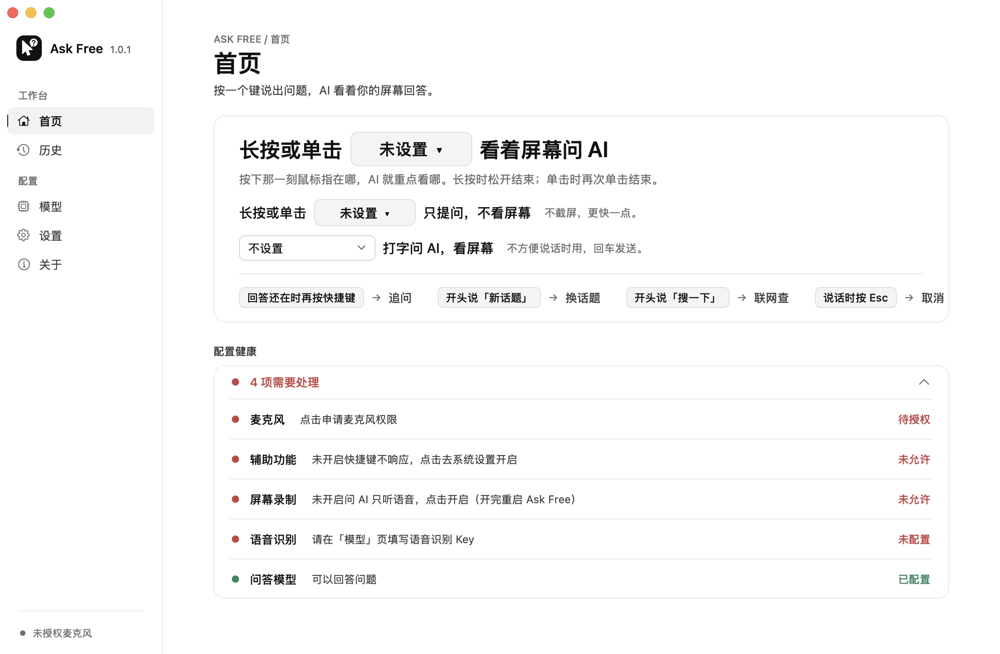
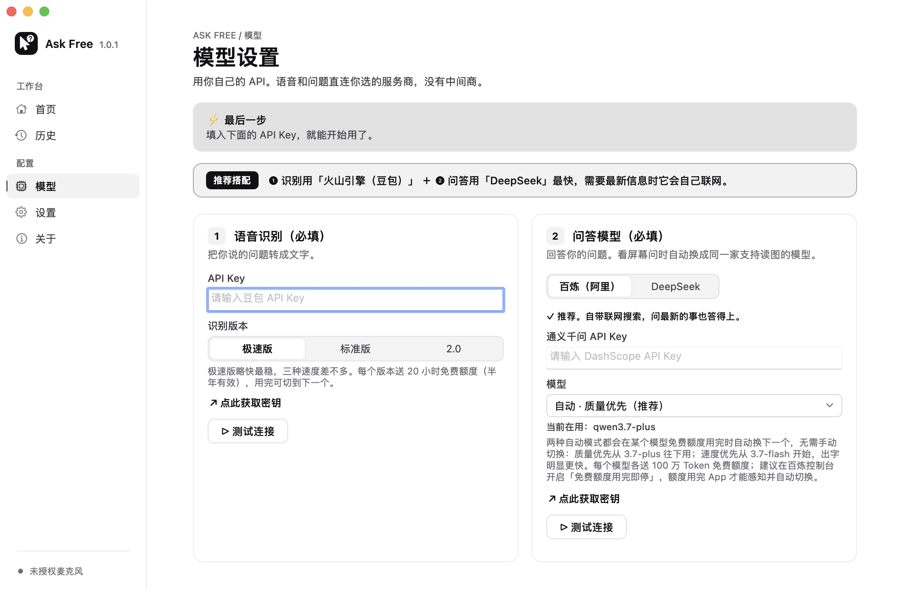
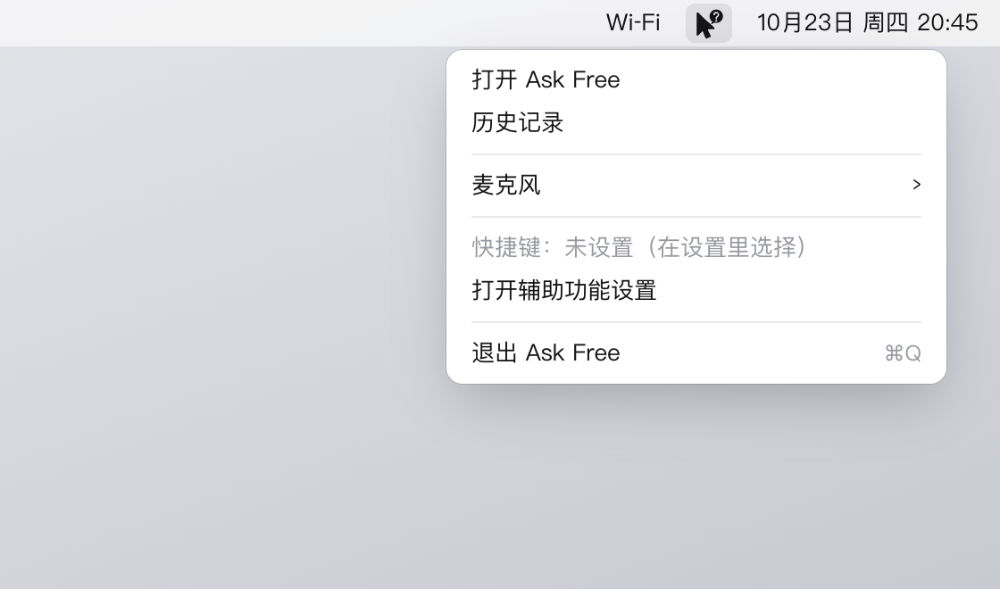

# Ask Free 欢迎引导和菜单栏菜单重新设计：第一次打开就会用

- 第一次打开 Ask Free 先出欢迎引导，主窗口不自动打开：授权三项、填两个 Key（带获取 Key 的链接和测试连接）、自己选提问键、真的试问一次。两个方向都能在下面从头点到尾，辅助功能和屏幕录制要把图标真的拖进系统设置的列表。
- 菜单栏菜单重排：第一行写现在能不能问、还差哪几项；麦克风直接写在用哪个；加上「打字问 AI…」和「设置…」；去掉一直挂着的「打开辅助功能设置」。
- A「侧栏步骤」是一个窗口六步，左边步骤清单，和 GetNewWord 的欢迎页同一副骨架；B「菜单栏小窗」是从菜单栏图标垂下来的一张清单，试问在你真实的屏幕上做。
- 引导和主窗口「开始」三步用同一份进度：走完引导，主窗口直接是首页；中途关掉，菜单里「继续设置…」回到引导，主窗口「开始」页也能补。
- 我推荐 A，请挑一个。

## Diagnosis

现在没有欢迎引导：第一次打开直接进主窗口，要做的事散在首页、模型页和菜单栏三处。前两张是开发版的真截图（新装、没填语音 Key、没授权麦克风），第三张菜单按代码还原。

1. 页面最显眼的是一句夹着三个「未设置」的大字，看不出提问键是第一件要做的事，也没说没设键就问不了。
2. 还没问过一次，就先教追问、换话题、联网、取消，最后的「取消」贴着卡片右边。
3. 麦克风一行只写「点击申请麦克风权限」，像说明，不像按钮。
4. 辅助功能、屏幕录制写的是「点击去系统设置开启」，看不出要把图标拖进列表；屏幕录制开完还要重开 Ask Free，只在括号里提了一句。
5. 两个 Key 写的是「请在模型页填写」，要换一页去填，填完再回来看。
6. 侧栏底部又说一遍「未授权麦克风」，和上面的清单重复。
7. 绿框：这句把「鼠标指在哪 AI 就看哪」说清楚了，两个方向的欢迎页都沿用。

1. 标题叫「最后一步」，前面几步在哪里没说。
2. 推荐搭配是一行字，不能点一下就选上；下面问答卡里默认选中的却是百炼，和推荐对不上。
3. 识别版本和免费额度的说明，要读完才知道该选哪个。
4. 四行自动换模型的说明夹在中间，第一次用的人用不上。
5. 绿框：「获取密钥」和「测试连接」两个动作是对的，两个方向都保留，放到 Key 输入框旁边。

1. 第一眼看不出现在能不能问；没填 Key、没授权时菜单和设置好时一模一样。
2. 「麦克风」要点进子菜单才知道用的是哪个。
3. 快捷键是一行灰字「未设置（在设置里选择）」，叫你去设置却点不了；菜单里也没有「设置」这一项。
4. 「打开辅助功能设置」一直挂着，授权好了也在；屏幕录制和麦克风却没有对应的项。
5. 图标右下角的蓝点只表示「没用默认麦克风」，设置没完成时图标没有任何提示。

还有一件截图上看不到的：一打开 Ask Free，代码会马上同时弹麦克风和屏幕录制两个系统授权框，这时用户还不知道这是什么软件、为什么要这些权限。

## Direction A: 侧栏步骤

一个窗口六步：左边步骤清单显示做到哪、能点着跳，右边一屏一件事，底部「继续」。和 GetNewWord 的欢迎页同一副骨架，主色换成 Ask Free 图标的墨黑。

### A1 欢迎

上面一段会动的示意：指针移到柱子上，按下提问键，说出问题，右上角出回答。下面三张卡说接下来做什么，大约 3 分钟。左下角的黑条只在原型里，能直接跳到任意一步。

### A2 授权

麦克风点「允许」弹系统框；在系统框里点「不允许」能看到被拒绝后怎么补（打开系统设置，把开关打开，麦克风列表不能拖）。辅助功能、屏幕录制点「打开系统设置」，系统设置右边浮出 Ask Free 图标，按住拖进左边的列表就好。屏幕录制拖完，系统请你重开，选「退出并重新打开」后引导回到同一步。三项里下一项该做的按钮是黑的。

### A3 两个 Key

语音识别、问答模型各一步。推荐的服务商已经选好，卡片上写它好在哪、送多少免费额度；Key 框下面一行是获取 Key 的链接和一句怎么拿。随便输 10 个以上字符点「测试连接」能看到成功，少于 10 个看到失败时怎么说。两步都选百炼时，第二步写「用上一步的百炼 Key」，不用再填。识别版本、模型放进「更多选项」，默认就是推荐的那个。

### A4 提问键和试问一次

提问键这一步不预设：点一颗常用的键，或点「按一下录一个键」后真按一下键盘。选 fn 会提醒去系统设置关掉 🌐 键；只提问、打字问两种收在「再加两种问法（可选）」里。试问这一步：把鼠标指到图上，先点一下原型再按住右 Option 说话（或按住屏幕上的「按住这里也能问」），松开后右上角出回答，下面三项打勾；回答还在时再按一次就是追问。

### A5 菜单栏菜单

第一行是状态：能问时写「可以提问 · 按住右 ⌥ 看着屏幕问」；没设完时写「还不能提问 · 还差 2 项：…」，下面多一项「继续设置…」，回到引导里没做完的那一步，菜单栏图标右下角挂一个橙点。麦克风那一行右边直接写在用哪个，不再用图标上的蓝点表示。点完「完成」，图标下面弹一句「Ask Free 住在菜单栏这里」。

## Direction B: 菜单栏小窗

第一次打开时从菜单栏的 Ask Free 图标垂下一张清单：授权、接上 AI、提问键一页看全，哪项先做都行；全做完点「试问一次」，在你真实的屏幕上问一句。

### B1 清单

授权三项在行里直接点，和 A 一样拖图标。点授权时小窗先收起，给系统设置和拖图标面板让地方，授权完自己再垂下来。顶上一排六格进度；点 × 或「稍后再设」收起，图标上留橙点，点图标回到清单。

### B2 填 Key 和选键

服务商用分段按钮，Key、测试连接、获取链接和 A 相同；测通后这一行收起成一行「火山引擎 · 极速版 · 已连上」，下一项自动展开。小窗窄，提问键的选项排两行；只提问、打字问不进引导，留到设置里加。

### B3 试问一次

在真实的屏幕上问：引导卡指着背后网页里的图，按住提问键说话，回答出现在右上角。指着图下面那段字问，回答会换成讲那段话，能看出「指在哪就看哪」。通了以后卡片换成追问、新话题、搜一下、Esc 四个用法，点「完成」。

### B4 菜单栏菜单

设置完以前点图标出清单，设置完以后出菜单，菜单内容和 A 相同。

## 两个方向都按的规矩

- 和主窗口「开始」三步怎么分工：第一次打开只出欢迎引导，它负责一步一步带着做、说清为什么、最后试问一次；主窗口「开始」页负责之后回来补、看还差什么。两边读写同一份进度（Key、三项授权、提问键），在哪做完，另一边一起打勾。走完引导，主窗口「开始」直接变「首页」；中途关掉，菜单栏图标挂橙点，菜单「继续设置…」重开引导停在没做完那步，主窗口打开时「开始」页列着同样几项，在那里补也行。试问一次只在引导里，主窗口保留「看一遍演示」。
- 和主窗口方案对齐后的用词：授权按钮叫「允许」（麦克风）和「打开系统设置」（另外两项），提问键没有默认值，Key 先测通再算做完。
- 和另外三块拼成一家：主色是图标指针的墨黑（深色模式反过来是近白），只给一屏唯一的实心按钮、选中的卡片和键、焦点框；绿、橙、红只表示状态；字用系统字体加苹方，13 正文、12 次要、15 小节名、22 大标题；圆角 5 键帽、6 按钮和输入框、8 分组和卡片、10 示意图、12 窗口和弹层；图标一套 16 的细线图标。和主窗口那块的界面标准草稿 `design/main-window/redesign/DESIGN.draft.md` 一致。
- 和主窗口方案不一致、要定一个的地方：一是顺序，主窗口「开始」是先填 Key、再授权、再选键，引导是先授权（跟「启动就要权限」）、再填 Key、再选键，我建议两边都用引导的顺序；二是引导每一步的标题用 22，界面标准草稿里 22 只给首页大标题、页名是 17，引导窗口算一张「首页」，草稿确认时写进去；三是引导左边是两行的步骤（名字加一句说明），比设置侧栏的单行宽一些，不和设置侧栏混用。
- 菜单栏菜单和系统授权框是 macOS 自己画的：菜单高亮和授权框按钮用系统的强调色（默认蓝），不是 Ask Free 的墨黑，这不算违反「不用系统蓝」。主窗口原型里的菜单只是示意，以这里的为准。
- 项目根目录还没有 `DESIGN.md`，诊断按通用原则和那份草稿下的判断；草稿要你确认后才放到根目录。
- 第一次打开时，系统授权框不再一启动就弹，改成引导第二步由你点按钮时再弹；仍然是一打开软件就要权限，只是先说清为什么。
- 引导的进度存下来：关掉、重开 Ask Free 后回到没做完的那一步。
- 跟了这些偏好：Ask Free 和 GetNewWord 同家族、引导用侧栏步骤和设置页侧栏图解（A 的骨架）、授权图标从右往左拖、拖图标授权、快捷键默认不设、启动就要权限、弹窗不抢焦点（回答面板照旧不抢焦点）、指针标记不画圆心（回答里的截图只画细红框）、指针问号图标、卡片别贴边、配色方案要真不同（两个方向结构不同）、ReLecture 产品设计主旨（A 的结果行和提示行预留高度，不跳动）、用户点名的交付格式。
- 旧偏好「沿用原界面」已经换成「Ask Free 和 GetNewWord 同家族」，按新的。
- 冲突：GetNewWord 的欢迎页你先选过「居中卡片」，后来改成「侧栏步骤」，A 按后一次。

## Not done

- 没启动开发版：菜单栏菜单按代码还原；首页、模型页的截图是主窗口那位设计师用开发版截的。
- 回答面板和录音胶囊只画到能看懂流程，样子以提问浮层那一块的方案为准。
- 原型里的授权、测试连接、语音识别和回答都是模拟的，按固定时间变成成功；网页收不到 fn 键，选 fn 时用屏幕上的按钮试问。
- 系统设置是示意，不是 macOS 真界面；拖进列表时 macOS 有时会要你输密码或按指纹，原型里没画。
- B 的清单点开一行会往下长，下面的行跟着下移；A 没有这个问题。
- 没改代码，没提交。

## Recommendation

我推荐 A：六步一步一屏，每一步有地方把为什么、怎么拿 Key、出错怎么办说完整，左边清单一眼看到做到哪，和你在 GetNewWord 选的欢迎页是同一副骨架。B 更轻、试问在真屏幕上更真实，但四百宽的小窗挤，点开一行会把下面推下去，授权时还得收起再垂下来；如果你喜欢 B 那种在真实网页上试问，可以把它换进 A 的最后一步。

| | A 侧栏步骤 | B 菜单栏小窗 |
|---|---|---|
| 出现在哪 | 屏幕中间一个窗口 | 菜单栏图标下面垂下来 |
| 怎么走 | 一步一屏，左边清单可点着跳 | 一页清单，哪项先做都行 |
| 填 Key | 服务商卡片加说明，一步一个 | 分段按钮，点开一行就地填 |
| 提问键 | 主键加两种可选问法 | 只选主键，其余去设置里加 |
| 试问一次 | 窗口里放一张示例图 | 在背后真实的网页上问 |
| 授权时 | 窗口不动，系统设置盖在上面 | 小窗先收起，授权完再垂下来 |
| 关掉以后 | 菜单里「继续设置…」回到那一步 | 点图标回到清单 |
| 和 GetNewWord | 欢迎页同一副骨架 | 不同 |
