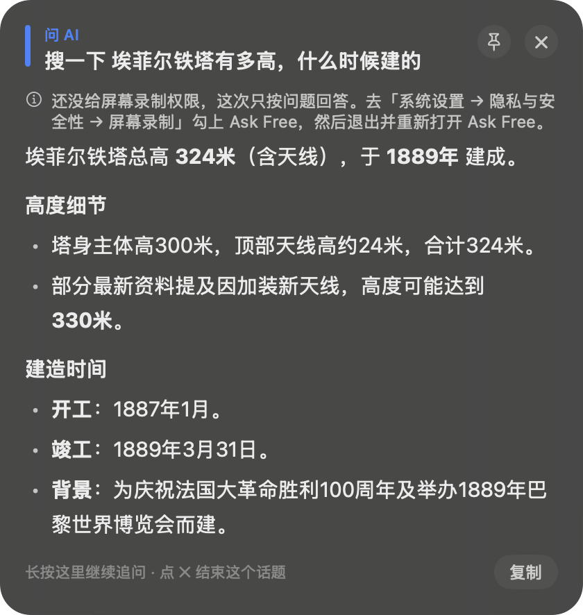
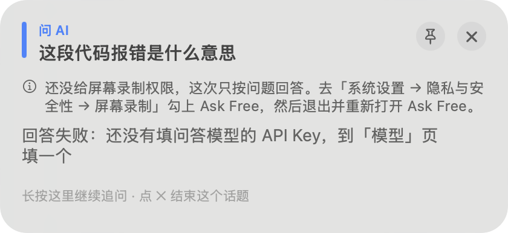

# Ask Free 提问浮层重做：录音胶囊、回答面板、打字提问框

- 两个方向结构不同：A「右上对话卡」回答固定出在右上角一张卡里，追问在卡里连成一条编号的线，换话题时旧话题折成一行；B「指针旁气泡」录音、回答、打字都在你指的地方旁边，同一个气泡里多一页是追问，换个地方冒出新气泡是新话题。
- 报错都改成能直接解决：没填 Key 有「去填 Key」，填好一键「回去问」刚才那句；没给屏幕录制有「去授权」，拖图标进系统设置；超时和 Key 无效有「重试」；麦克风只能系统里开，就给「打开系统设置」。
- 两个原型都能真点：底部黑条按住「按住提问」说话、「说「新话题…」」、「打字问」、七种报错、换网页 / 视频 / PDF 背景、快捷键已设 / 没设；点一下原型画面后，按住 Option 说话、连按两下 Control 打字，视频上按空格照常暂停。
- 我推荐 A：回答都是成段的话，固定在右上角不盖住你正指着的东西，眼睛也知道去哪找；B 更贴着问题，适合短问短答。
- 主色、字体、圆角、方角开关照主窗口方案的 `DESIGN.draft.md` 对齐，不一样的两处写在「四块怎么拼成一家」。

## Diagnosis

两张都是开发版 Ask Free Dev 的真截图（`-askText` 在指针处问一句）。开发版这时没有屏幕录制权限，所以两张上都有那条没看屏幕的灰字。录音胶囊要按快捷键才出来，我不能替你按，没有截到。

1. 左边一条蓝竖条，上面「问 AI」小蓝字，下面才是问题。蓝条和标签不说任何事；追问时只是变成「问 AI · 第 2 轮」，一眼看不出这一问是接着聊还是新话题。
2. 图钉和关闭是两个灰色实心圆，和底栏的「复制」三个按钮两种样子。
3. 真正要紧的事（这次没看屏幕，只按文字答）是一段 12 号灰字加一条系统设置的路径，没有按钮；回答照常往下出，很容易没看见。
4. 整张是 22 圆角的灰色磨砂板，浅色下是一块灰白板，深色下是一块深灰板；小标题和正文都是 15 号，只靠加粗分。
5. 底栏「长按这里继续追问 · 点 ✕ 结束这个话题」：长按面板任意处是藏着的手势，快捷键默认不设时这是唯一的追问办法。
6. 「复制」要等回答出完才出现在底栏，出现时底栏这一行会变。

1. 「回答失败：还没有填问答模型的 API Key，到「模型」页填一个」用的是回答一样的大灰字，没有按钮，得自己去菜单栏打开主窗口找「模型」页。
2. 上面还叠着一条没看屏幕的灰字：一次出了两个问题，哪个先解决、怎么解决都没说。
3. 已经答失败了，底栏还在教「长按这里继续追问」，图钉也还能点。

## Direction A: 右上对话卡

回答固定出在屏幕右上角一张卡里，卡顶一条状态条说现在在干什么，追问在卡里连成一条编号的线。

### A1 问一句、追问、换话题

- 说话时屏幕底部中间出现墨黑小胶囊：左叉号取消，中间音浪，「看着屏幕」小白点，右对勾说完；松手变「识别中」，然后胶囊收起，卡片从右边滑进来。
- 卡顶状态条一行字，按顺序换：「看着屏幕」「正在联网查」「正在回答」「已答 · DeepSeek」「已答 · 第 2 问 · DeepSeek」；右边钉住、复制、关闭三个同样的图标钮，复制一直在。
- 问题 15 号加粗，右边一张小缩略图是这次发给 AI 的画面（细红框框着你指的地方），点开看「指着的地方」和「整个屏幕」两张。追问只发文字，所以追问那一轮没有缩略图。
- 追问：卡片不动，第一问前面出现编号 1，第二问是墨黑实心的 2，两个编号用竖线连起来；旧的一轮压成两行灰字，点一下展开。
- 换话题（开头说「新话题」，或者卡片关掉后再问）：旧话题折成卡顶一行「上个话题：… · 2 问」，下面一条「新话题」分隔线，状态条带一个「新话题」小标签。
- 底栏两个按钮「按住追问」「打字」，按你实际设的快捷键写上键帽（右⌥、双击 ⌃），没设就不写；右边一句「开头说「新话题」另起」。长按面板任意处追问这个藏着的手势去掉。
- 卡片只往下长，状态条高度固定，换状态不跳。点外面缩成一行问题，4 秒后淡出，鼠标停上去回满；钉住后点外面不收。你指的东西正好在右上角时，卡片换到左上角，不盖住它。
- 打字问：卡片底栏换成一行输入框「问点什么，AI 会看着屏幕回答」，回车发出、esc 取消，发出去键盘还给原来的窗口。

### A2 报错

报错就出在这一问的回答位置：左边一个事物图标加橙色或红色角标（钥匙、时钟、麦克风），一句标题说清是什么问题，一句话说怎么办，一个黑色主按钮加一个次要按钮。没看屏幕不算失败：回答上面一条橙色底的「这次没看屏幕：还没给屏幕录制权限」加「去授权」，点了打开系统设置，旁边浮出能拖的 Ask Free 图标，拖进列表、点「重开 Ask Free」，回来是「能看屏幕了 · 看着屏幕再问一次」。

## Direction B: 指针旁气泡

问题从哪里来，回答就出在哪里：按下说话键时你指的地方套上取景框，录音、回答、打字都是取景框旁边的一个气泡。

### B1 问一句、追问、换话题

- 按下说话键：指针所在那块套上取景框四角，和鼠标指针一样黑芯白边，深浅背景上都看得见（没有圆心标记），取景框右下角冒出一个小气泡「正在听，看着这里」，带叉号和对勾。屏幕底部不再出胶囊。
- 回答气泡贴在取景框旁边，小尖角指着它：右边放得下放右边，不然左边，再不行放下面，不盖住取景框。
- 气泡先只给第一段（15 号），下面「展开全部」看条目、来源和找到的图。气泡底栏左边写「DeepSeek · 看了这里」，右边按住追问、复制、钉住、关闭四个图标钮。
- 追问：气泡原地不动，顶上多出页签「1 他说的频域是什么意思」「2 举个生活里的例子」，点页签回看。
- 换话题：旧气泡缩小飞走，右上角闪一下「上个话题 2 问，已存进「历史」」，新的取景框和新气泡出在新的指针位置。规则一句话：同一个气泡里多一页是追问，换个地方冒出来是新话题。
- 钉住：气泡挪到右上角，点外面不收；取景框变淡。打字问：取景框旁边出一个输入气泡「问这里的东西…」。

### B2 报错

报错就在同一个气泡里，文案和按钮跟 A 一样。没给屏幕录制时取景框变成橙色，上面一个小标签「这次看不到」，气泡里同样是「去授权」拖图标。

## 两个方向都有的

- 浮层不抢键盘：回答出来时键盘还在原来的网页、视频上，空格照常暂停播放（原型里能按）；只有打字问时输入框拿键盘，回车或 esc 后还回去。
- 报错文案（DeepSeek 换成你当前用的那家；状态码、服务商原话不上面板，留在日志）：

| 情况 | 标题 | 下面那句 | 按钮 |
|---|---|---|---|
| 没填问答 Key | 还没填问答模型的 Key | 回答要用你自己的 AI Key。在「语音与模型」页填好 DeepSeek 或千问的 Key，就能接着问这一句。 | 去填 Key · 怎么拿 Key |
| 没填语音 Key | 还没填语音识别的 Key | 说的话要先转成文字，这一步用火山引擎的 Key。在「语音与模型」页填好就能说话提问；现在可以先打字问。 | 去填 Key · 改成打字问 |
| Key 无效 | DeepSeek 不认这个 Key | 可能复制少了几位，或者在官网删掉了。到「语音与模型」页重新粘贴，点「验证」试一下。 | 去换 Key · 重试 |
| 超时 | DeepSeek 30 秒没回应 | 已经自动重试了 2 次。可能是网络不稳，也可能是它正忙。 | 再试一次 · 换千问问 |
| 麦克风没开 | 麦克风没开 | 上次系统问的时候点了「不允许」。到「系统设置 › 隐私与安全性 › 麦克风」打开 Ask Free；这个只能在系统里开。 | 打开系统设置 · 改成打字问 |
| 没看屏幕 | 这次没看屏幕：还没给屏幕录制权限 | 回答照出，标在回答上面 | 去授权（拖图标） |
| 没听到 | 没听到问题 | 不算报错，1.6 秒后自己消失 | 无 |

- 「去填 Key」打开主窗口的「语音与模型」页，光标已经在当前那家的 Key 框里；验证通过后一个「回去问「…」」把刚才那句重新问一遍。原型里只画了这一角，主窗口长什么样以主窗口方案为准。

## 四块怎么拼成一家

照主窗口方案的 `design/main-window/redesign/DESIGN.draft.md` 对齐：

- 主色是图标里指针的墨黑：实心主按钮浅色黑底白字、深色白底黑字，一张面板最多一个；「正在听」时面板描一圈墨黑边，当前这一问的编号是墨黑实心圆。不用系统蓝，也不用 GetNewWord 的靛蓝。
- 唯一固定的红是发给 AI 的截图上那个细红框，只在缩略图里。状态色只在小图标和小底色上：橙是还差一步（没看屏幕、没填 Key），红是出错（Key 无效、麦克风关着），绿是好了（Key 能用、授权好了）。
- 底色、卡片、两级灰字、发丝线照 GetNewWord 的 `Theme.swift`；字体是系统字体加苹方；圆角键帽 5、按钮 6、块 8、浮层 12；图标一套 16 号、1.5 线宽、圆头；开关方角（原型里系统设置那一页）。
- 用的是「语音与模型」这个页名，跟主窗口方案改过的名字走；主窗口最后没改名的话换回「模型」。

和草稿不一样的两处，确认标准时一起定：

- 字号：草稿正文 13；浮层里回答正文用 14、问题用 15，长回答叠在网页和视频上读，13 太小。
- 录音胶囊是全圆的墨黑小条，不在草稿的圆角表里；它是屏幕底部的提示，照系统听写的样子。

## 跟了哪些偏好

- 跟了：Ask Free 和 GetNewWord 同家族（骨架、按钮、报错卡都照 GetNewWord 的查词面板）、弹窗不抢焦点（原型里空格照常控制视频）、底栏按快捷键设置（键帽按实际设的写，没设不提）、快捷键默认不设（原型能切「没设」看底栏）、授权图标从右往左拖和拖图标授权（屏幕录制「去授权」走拖图标）、查词面板别像白板（分层的状态条、编号线，不是一块灰板）、指针标记不画圆心和截图标记用细框（缩略图细红框，B 的取景框只有四角）、指针问号图标（状态条和菜单栏的 logo）、卡片别贴边、ReLecture 产品设计主旨（状态条高度固定、卡片只往下长）、配色方案要真不同和换色不算重设计（A、B 结构不同）、用户点名的交付格式、Toggle controls（方角开关）。
- 没有冲突：旧偏好「沿用原界面」已经换成「Ask Free 和 GetNewWord 同家族」。

## 替你定了的事

- 「问 AI」标签和左边蓝竖条去掉，换成状态条；浮层圆角从 22 改成 12，底色从灰色磨砂改成近实心的面板色，复杂背景上字也清楚。
- 长按面板任意处追问改成底栏一个看得见的「按住追问」按钮。
- 「复制」一直在，回答没出完时复制已经出来的部分。
- 没听到问题仍然只是一句轻提示，不弹报错。

## Not done

- 录音胶囊和底部提示条没有真截图：要按快捷键才出来，我不能替你按；诊断只评了回答面板和报错。
- 开发版这时没有屏幕录制权限，两张截图上都是没看屏幕的状态，截图缩略图那一排在现状里没截到。
- 原型里面板不能拖动和改大小；AI 的内容是写死的，按固定速度吐字；「去填 Key」只画了模型页一角。
- 现在设置里的录音浮窗「彩色」样式和「经典」控制方式，新设计里只画了墨黑一种，要不要留等你定。
- 多块屏幕、全屏视频的空间、English 文案没做。
- 没改任何代码。

## Recommendation

我推荐 A：Ask Free 的回答多是成段的话，有条目、有来源、有图，固定在右上角一张卡里不盖住你正指着的东西，眼睛每次都知道去哪找；追问的编号线和换话题的折叠行也比现在的「第 2 轮」清楚。B 的好处是问题和回答挨在一起，问「这个是什么」这种短问题最顺手，和 GetNewWord 的跟词浮签更像一家；代价是气泡会盖住你指的东西旁边那几行，长回答要点「展开全部」。

| | A 右上对话卡 | B 指针旁气泡 |
|---|---|---|
| 回答出在哪 | 右上角固定一处（你指的东西在右上角时换到左上角） | 你指的地方旁边，尖角指着它 |
| 挡住什么 | 屏幕一角 | 指的东西旁边那一块 |
| 第一眼看到 | 整段回答 | 第一段，其余点「展开全部」 |
| 追问 | 卡里编号 1、2 连成一条线 | 同一个气泡里多一个页签 |
| 新话题 | 旧话题折成卡顶一行，加一条分隔线 | 旧气泡飞走，新地方冒出新气泡 |
| AI 看了哪里 | 问题旁一张缩略图，点开看大图 | 屏幕上直接套取景框 |
| 录音时 | 屏幕底部墨黑胶囊 | 取景框旁一个小气泡 |
| 报错 | 卡里一块，带按钮 | 气泡里一块，带按钮 |
| 和 GetNewWord | 同一套状态条、按钮、报错卡 | 同一套，外加浮签的做法 |
| 做起来 | 改动小，位置和现在一样 | 要按指针位置摆气泡，录音换成气泡 |
