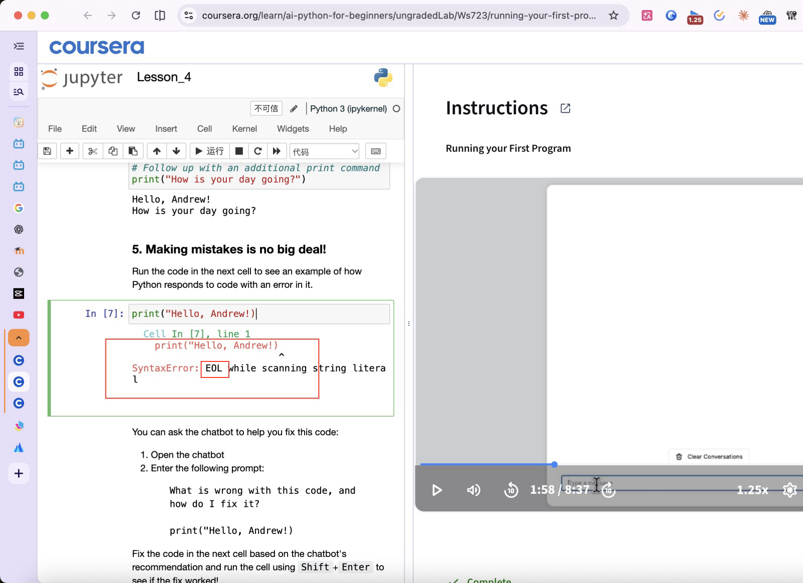

# Ask Free 问词认准、听错会改、讲代码，回答也更有料了

- 指着一个词问，Ask Free 先在本机认出指针正指着的那个词和那一行，截图上的框只框住它，再用文字告诉 AI；拿你 10 月 22 日问「eol?」那张截图试，认出「EOL」用了 0.5 秒左右，在你说话的那几秒里就做完了。
- 语音听错时，AI 结合屏幕上的字按你真正想问的答，卡上的问题换成改正后的，原话留一行小字：说「伊欧艾尔是什么意思」，卡上变成「EOL 是什么意思」。
- 指着代码、报错或终端里的命令问，自动按讲代码的方式答：错的和改好的并排，再把这一行拆开讲。
- 提示词重写了：去掉「200 字以内」和一串「不要」，输出上限从 600 放到 1500（讲代码 2400）。同样 5 个历史问题，新回答会讲言外之意、容易混的地方、常见的坑。
- 识别语音时把屏幕上的英文词和前几轮问答交给火山当热词，合成语音实测 5 句里 3 句认得更准，速度不变；豆包 2.0 带截图没看出效果，没用。
- 还没真测的两样：用键盘真说一句、选中文字再问，因为测的时候屏幕锁着。

## Where: 认词、纠错、讲代码

1. 改正后的问题和「听成」那行小字 · 回答卡顶上 · 按住提问键说话，识别听错时出现
2. 讲代码 · 回答卡正文 · 指着代码、报错或终端里的命令问
3. 截图上只框住指针下的词 · 发给 AI 的清晰图，历史页里能看到 · 看屏幕问时自动画

## What changed

- [卡上的问题换成改正后的](10-heard.png#mark=1)：AI 认定识别听错了才换，原话写在下面「听成「…」」；只差标点、换个说法不算听错，不换。
- [错的和改好的代码并排](11-code.png#mark=1)：指针那一行像代码（括号、关键字、报错行），或者指针所在的 App 是编辑器、终端，就加一段讲代码的要求。
- [把这一行拆开讲](11-code.png#mark=2)：在做什么、每部分是什么、报错原因和改法，挑这次用得上的讲。
- [截图上只框住指针下的词](13-marker-after.png#mark=1)：认不出字时（图片、视频画面）照旧画以指针为中心的大框。
- 选中了文字再问时，用选中的那段（辅助功能读出来的，要在指针所在的那个控件里，别处早先选的不算）。
- Vision 认中文时会把代码里的括号认成全角（print（"Hello, Andrew！）），交给 AI 前换回半角。
- 开了思考时，「模型在先想一下，马上出答案」这行提示以前答完还挂着，现在出字就清掉。
- 关于页「发给谁、发什么」、官网隐私说明、README 都写上了：识别时多发指针附近的英文词和前几轮问答，回答时多发本机认出的字和选中的文字。

## 改前改后

截图上的框：以前框住一片，现在只框那个词。

### 1. 问「eol?」那一刻
- 以前： 以指针为中心 320×90 点的框，里面有 print、SyntaxError、EOL、while、scanning 十来个词
- 现在： 外面的大框是 10 月 22 日那张旧截图上本来就有的；里面紧贴 EOL 的小框是新画的

## 回答为什么更有料

同样的问题，旧提示词和新提示词各问一次 DeepSeek（关思考），原文都在记录里。

- [5 个历史问题改前改后的回答原文](prompt-compare.json)：跑这一组时纠错那段还没收紧，改后的两条开头多了一行「[[问题: …]]」，App 里这一行不显示，收紧后也不再乱写。
- 「CF 旁边这个是什么意思啊」：以前 169 字，说 A♭ 是降 A、在键盘哪；现在 385 字，多讲了为什么小三和弦是 A♭ 而不是 A、屏幕上 C·F·A♭ 只是转位、容易和 ♯ 记反。
- 「这句话啥意思」：以前 180 字，翻译了一遍；现在 572 字，翻译之外解释了 artifacts、CI，点出作者为什么专门解释这一句。
- 「什么叫做 WebSocket」：以前按「区别、用途、示例」三段列；现在打了个电话不挂断的比方，补上心跳和自动重连这个常见的坑，字数反而少了。

## 识别带上屏幕的字

合成语音（macOS 的中文声音念中英混说的句子）喂给火山极速版，带和不带屏幕上的字各认一次。

- [5 句录音的识别结果和用时](asr-compare.json)
- 认得更准的 3 句：artifacts（不带时认成「R U I」）、no stream（「诺斯壮」）、open in（不带时整句编成「播放音乐」）。
- 另外 2 句两边都没认出 EOL、A flat；带上下文时把认不清的词丢掉了，没认成别的词。这时 AI 还能从「指针正指着 EOL」那段文字知道问的是什么。
- 豆包 2.0 带截图当上下文：同一句没变好，还慢半秒；2.0 极速版这个账号没开通。所以只用极速版加文字上下文。

## 替你定了的事

- 「听成」那行小字放在问题正下方，灰色 12 号字；历史里记改正后的问题。
- 打字问不加「可能听错」那段，打的字不会听错。
- 识别时的热词只取英文和代码里的名字，不取中文：一行中文切不准，乱塞热词火山文档说反而容易误认。
- 认字只认指针周围 900×300 点一块，不认整屏，0.5 秒左右做完；整屏要 1 秒多。

## Evidence

- 核心库测试：369 个通过，2 个本来就跳过（`swift test`）；新加了认词、代码判断、纠错标记、识别上下文的测试。
- 开发版拿 10 月 22 日的真实截图当屏幕真问：认字 0.46 到 0.57 秒，认出 EOL；「伊欧艾尔是什么意思」答成「EOL 是什么意思」并出「听成」；「这行代码哪里错了」认成代码，按讲代码的方式答。
- 纠错标记：7 个问题实测，真听错的 2 个改了（伊欧艾尔改成 EOL，in-guarded 改成 integrated），没听错的 5 个不出「听成」。
- 启动自测通过；官网用 Chrome 打开没有脚本报错、没有断链。

## Not done

- 用键盘真说一句（录音、识别带上下文、出「听成」整条路）没测：测的时候屏幕锁着，录音要你按键说话。
- 选中文字再问没测：要在别的 App 里选中文字，屏幕锁着点不了。
- 百炼识别没加上下文，百炼现在只对老用户显示。
- 正式版没换，官网没部署。
