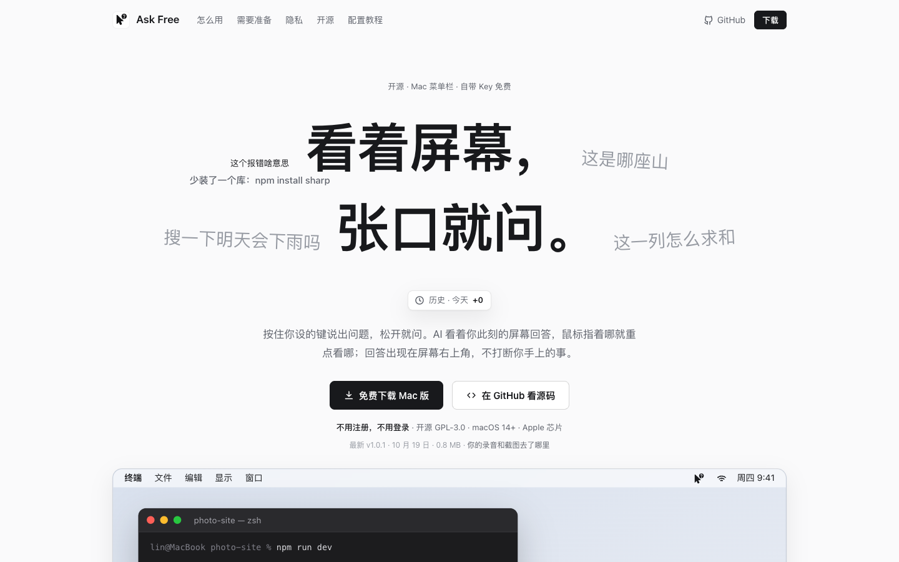
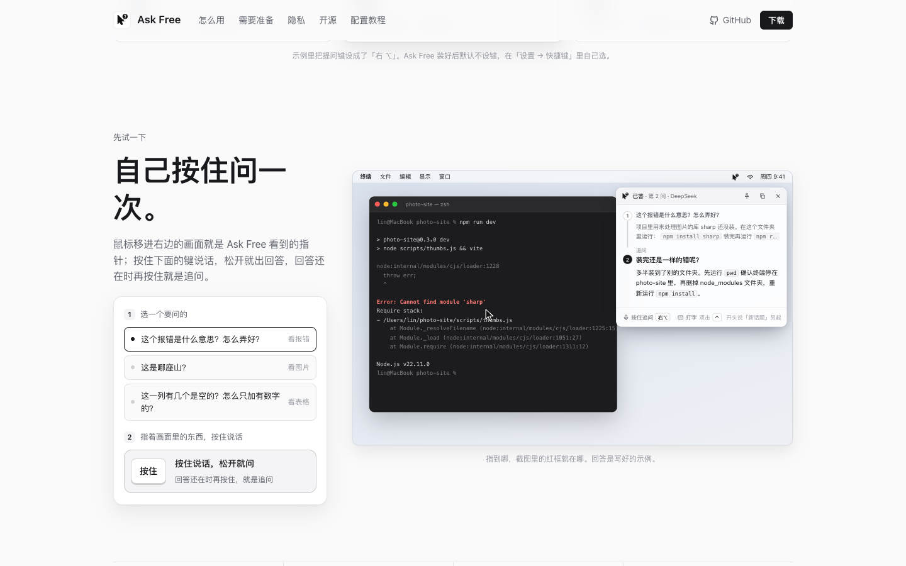
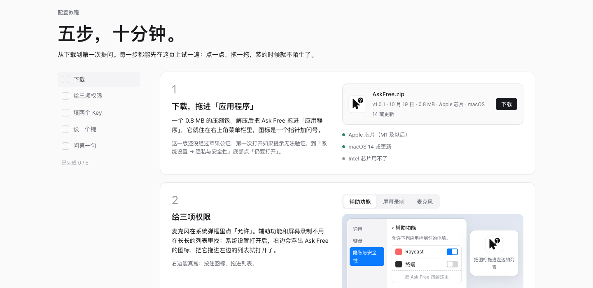
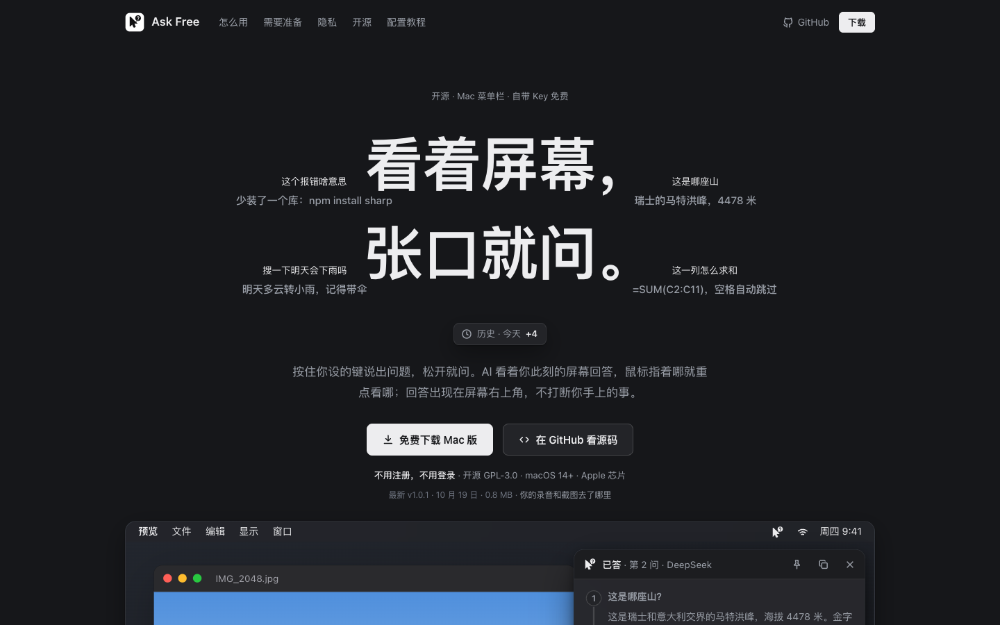

# Ask Free 重新设计做出来了：主窗口、欢迎引导、提问浮层、官网

- 四块都照你选的 A 方案做完了，开发版上真点过、真问过，和 GetNewWord 一家的样子：墨黑主色、方角开关、按钮圆角 6。
- 回答卡换成右上对话卡：卡顶状态条，追问连成编号线，换话题时旧话题折成一行，报错带「去填 Key」「重试」这样的按钮。
- 官网在仓库 `website/index.html`：A 当首页，下面加了 B 那块能按住提问的桌面，「配置教程」页是 B 的五步上手；没部署，部署前问你。
- 还差一件只有你能做的：开发版的「辅助功能」和「屏幕录制」还关着。开了以后我测「试问一次」和看屏幕问，再换正式版。

## Where: Ask Free 新界面

1. 回答卡 · 屏幕右上角 · 按住提问键说话，或双击打字键打字
2. 主窗口「开始」页 · 主窗口侧栏第一项 · 点菜单栏图标 → 打开 Ask Free
3. 欢迎引导 · 第一次打开时 · 菜单栏 →「继续设置…」
4. 官网首页 · 仓库 `website/index.html` · 浏览器直接打开这个文件

## What changed

- [「开始」页三步](01-start.png#mark=1)：还没配好时按先授权、再填 Key、再选提问键排，做完变「首页」。
- [侧栏状态卡](01-start.png#mark=2)：写还差几步、差哪几项。
- [欢迎引导六步](02-onboarding.png#mark=1)：第一次打开先出引导，不再一启动就弹系统授权框；第 3、4 步进来就自动测一次 Key。
- [选键菜单挂在键帽下面](03-hotkeys.png#mark=1)：以前跟着鼠标弹，用辅助功能点时弹不到地方；撞键先问一句。
- [历史按问法筛](04-history.png#mark=1)：新问的问题记下是看屏幕问、只提问还是打字问，有没有联网。
- [历史列表](04-history.png#mark=2)：能搜，上下键换一条，删一条后侧栏和页头的条数跟着变。
- [录音浮窗样式](05-recording.png#mark=1)：彩色、墨黑两种，上面的示意跟着换。
- [回答卡状态条](10-answer.png#mark=1)：「在想」「正在回答」「已答 · 第 2 问 · DeepSeek」，高度固定，换状态不跳。
- [这次没看屏幕](10-answer.png#mark=2)：以前是一段小灰字，现在是橙底一条，点「去授权」直接打开系统设置的屏幕录制页，旁边浮出能拖的图标。
- [底栏两个按钮](10-answer.png#mark=3)：「按住追问」代替以前藏着的「长按面板任意处」；「打字」点一下弹出打字框。
- [编号追问线](11-follow.png#mark=1)：第 2 问是墨黑实心圆，竖线连着第 1 问。
- [旧的一轮压成两行](11-follow.png#mark=2)：点一下展开全文。
- [换话题](12-new-topic.png#mark=1)：卡片还开着时开头说「新话题」，旧话题折成卡顶一行。
- [报错卡](13-error.png#mark=1)：Key 无效、没填 Key、额度用完、超时、断网各有一句标题和按钮；认不出的原样写出来，带「再试一次」。
- [官网「先试一下」](21-site-try.png#mark=1)：选问题、按住键帽说话，再按住就是追问；在配置页录了键以后按键盘上那个键也行。
- [官网演示里的回答卡](21-site-try.png#mark=2)：和 App 里的新卡片同一个样子，胶囊是墨黑的，不再用蓝色光环和彩色音浪。
- 官网的下载按钮读 GitHub 最新一版，直接下到 `AskFree-1.0.1.zip`；版本号、日期、大小也从那里读，读不到就不显示那一行。
- 主窗口第一次打开在屏幕正中，以前贴着左下角。

## Scenes

### 官网

- 首页： 大标题夹着灰色问句，一句句被听懂、给出答案，再收进「历史」
- 先试一下： 鼠标就是画面里的指针，按住说话出回答
- 配置教程： 五步上手，每步能在页面上真点，做完打勾
- 深色： 跟随系统

## 替你定了的事

- 语音识别默认只显示火山引擎，阿里百炼只对已经在用它的人显示（代码里 9 月 15 日定的，原型画了百炼选项，我按代码来）。
- 新用户在引导里默认选 DeepSeek；录键弹窗去掉了「恢复默认」，因为现在没有默认键。
- 语音与模型页的链路「回答 ✓」改成只看选中那家有没有 Key：以前选了 DeepSeek、框是空的，也会因为别家有 Key 打勾。
- 录音胶囊本来就是方案里的墨黑全圆、叉号和对勾，这次没动；方案里胶囊上的「看着屏幕」几个字没加。
- 打字框还是一条单独的框，贴在回答卡下面、同宽同圆角；方案里是换掉卡片底栏，那样要让回答卡自己接键盘，改动大，先没做。
- 官网样式跟 App 走：标题用系统字体，不用宋体；按钮圆角 6，不用胶囊形；没有问答蓝。画出来的 macOS 系统设置里那几个开关还是系统蓝，因为画的是系统的界面。
- 官网首页保留了 A 的自动演示，B 的能按的桌面放在它下面；B 的五步上手当「配置教程」页；「简 / EN」先拿掉了，英文版没写。

## Evidence

- 核心库测试：142 个全过（`swift test`，AskFreeCore）。
- 开发版用固定证书签名（3H5S5NXPXS），编译通过。
- 主窗口真点：火山和 DeepSeek 的 Key 从界面打字填进去，「验证」都显示「能用，已存好」；三颗键帽各选一个键，撞键弹「保存并清空」确认；历史搜索、筛选、上下键、删除一条（历史文件 4 行变 3 行）。
- 引导真走：第 1 到 5 步，第 3、4 步进来自动测试通过，「继续」能点。
- 回答卡真问：启动参数问一句、点「打字」追问一句、开头说「新话题」换话题、点「复制」（剪贴板是去掉 Markdown 符号的回答）、点「去授权」打开屏幕录制页。
- 报错真走：把 DeepSeek Key 改成错的问一句，出「DeepSeek 不认这个 Key」；点「去换 Key」打开语音与模型页，填回正确的 Key，点「重试」，同一个话题里 1.2 秒答出来。
- 按住「按住追问」开始录音，松开去识别（日志里 START recording 和一次火山识别）。
- 官网用 Chrome 真点：按住提问和追问、配置页拖图标三项、填 Key、录「右 ⌥」后回首页按这个键问一次，都没有脚本报错；手机宽 390 不横向滚动。
- 提交：1c81648、f080da9、284c87c、2100e2a、7acf015。

## Not done

- 「试问一次」和看屏幕问没真测：开发版的辅助功能和屏幕录制还关着，要你在系统设置里打开。
- 正式版 `/Applications/Ask Free.app` 没换，M1 没同步：等你看完这页确认。换的时候正式版要重新授权一次，因为证书从临时签名换成了固定证书。
- 官网没部署：askfree.us-cloud.uk 还解析不到，放 GitHub Pages 还是别处等你定；这一版没公证，网站照实写了「仍要打开」。
- 点外面缩成一行、钉住、按住追问拖开取消这几处没用真鼠标测：辅助功能点不出「点到 App 外面」，按住追问只测了按下和松开。
- 开发专用的启动参数问「新话题 …」时不去掉「新话题」几个字，平常用不会走这条路，没改。
