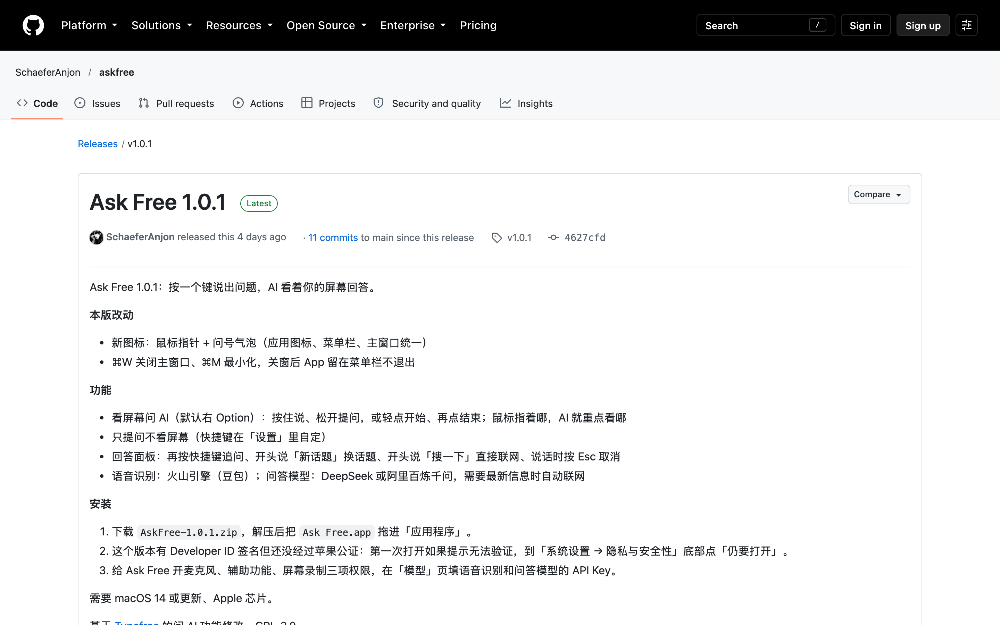

# Ask Free 官网：askfree.us-cloud.uk 两个方向

- 现在 Ask Free 没有官网：askfree.us-cloud.uk 还解析不到，外面的人只能看到 GitHub 的发布页。两个方向都是从零做的一整个网站，和 GetNewWord 官网同一套骨架：浅色留白、大号宋体标题、黑白两个按钮、会动的演示、深色隐私区块。
- A「张口就问」照 GetNewWord 你选的那版讲：大标题里夹着灰色问句，一句句被「听懂」、冒出答案，再收进「历史」；下面是自动播放的三幕演示，往下讲怎么用、要准备什么。另有配置教程页和隐私说明页。
- B「先试再装」首屏就是一块能用的 Mac 桌面：选一个问题，鼠标移进去就是指针，按住按钮说话、松开就出回答，再按住就是追问；下面是五步上手，下载、拖图标授权、填 Key、录一个键、问第一句，每一步都能在页面上真点。
- 我推荐 A，并把 B 的「先试一下」留作 A 演示区的下一步（理由和对比在最后）。
- 主色和另外三块一致：主按钮是图标里指针的墨黑；问答蓝只在「AI 在听、在答」那一刻出现，和提问浮层方案同一个蓝。快捷键在网站上一律写「示例键，默认不设」。
- 项目根目录没有 `DESIGN.md`，我起草了网站部分 `DESIGN.draft.md`，等你批准，批准前不拿它评判任何东西。

## Diagnosis

现在想下载 Ask Free 的人只能打开 GitHub 的发布页。下面是没登录 GitHub 的人打开 `releases/latest` 看到的真实页面（10 月 23 日截）。

1. 第一眼是 GitHub 的英文导航和「Sign in / Sign up」，不懂编程的人会以为要先注册 GitHub。
2. 正文一开头是写给老用户的「本版改动」（新图标、⌘W 关窗），新来的人看不出这个软件长什么样，整页没有一张图。
3. 功能里还写着「默认右 Option」，可现在已经改成默认不设键，照着做会按了没反应。
4. 安装要先绕去「系统设置 → 隐私与安全性」点「仍要打开」：这一版有签名但没公证，官网上要把这一步写清楚，不能藏。
5. 绿框这句「按一个键说出问题，AI 看着你的屏幕回答」把软件说清楚了，两个方向的首屏说明都从它来。

文件 `AskFree-1.0.1.zip` 在这一屏下面，名字带版本号，每发一版下载链接就变；我用 `curl` 试过 `releases/latest/download/AskFree.zip`，现在打开是 404。

## Direction A: 张口就问

和 GetNewWord 官网 A「框词即懂」同一种讲法：大字标题「看着屏幕，张口就问。」之间夹着四句灰色的问句。

### A1 首屏动画

一个小录音胶囊（照应用：深色胶囊、粉紫蓝音浪、蓝色光环）跳到第一句灰色问句下面，问句一个字一个字变成问答蓝，表示被听懂，摆正，下面冒出一行答案；四句轮完（「这个报错啥意思」「这是哪座山」「搜一下明天会下雨吗」「这一列怎么求和」），一起缩小飞进标题下面的「历史 · 今天 +N」小牌，数字跳一下，停两秒再来。鼠标移上去马上停住，四句同时摆正、带着答案。问句飞走后原位留空，标题不挪动。

### A2 三幕演示和往下的区块

舞台三个标签轮播、能点：「看报错」指着终端里的 `Cannot find module 'sharp'` 问，回答直接给 `npm install sharp`；「看图片」问照片里是哪座山，接着追问「从苏黎世怎么过去」，面板变成「问 AI · 第 2 轮」；「看表格」指着金额那一列问空格和求和，回答给公式和结果。每一幕都是：指针移过去、左下键帽按下、胶囊亮起音浪、松开「识别中」、右上角回答面板出来，面板里有发给 AI 的截图缩略图，细红框框着你指的地方。往下：四格事实（开源、账号、快捷键、历史）；「按住，说，松开」三种问法和回答还在时的四个说法；历史页样子；「准备三样」（Mac、两个 Key、三项权限，权限那张卡会自己演示拖图标）；隐私；开源；三步开始；常见问题；结尾下载。导航「配置教程」是单独一页，DeepSeek 和百炼能切换。

## Direction B: 先试再装

首屏不讲道理，直接给一块能用的桌面；往下按「从下载到第一次提问」五步排，没有单独的配置教程页。

### B1 首屏：自己按住问一次

左栏是标题、一句说明和「试一下」卡：先选三个问题之一（演示画面跟着换成终端、照片或表格），再按住大键帽「按住说话」。鼠标移进画面就是 Ask Free 看到的指针，截图缩略图里的红框跟着你指的位置走。按不到半秒松开，胶囊显示「没听到问题」，和应用一样；回答还在时再按住，就是第 2 轮追问。在第 4 步录好键以后，按住键盘上那个键也能问。手机上可以用手指按住。

### B2 五步上手

左边一列步骤，做完一步打勾。1 下载：文件卡和芯片、系统要求，写明「仍要打开」。2 权限：画出系统设置，右边浮着 Ask Free 图标，真能按住拖进列表，辅助功能、屏幕录制各拖一次，麦克风是系统弹框点「允许」。3 两个 Key：两个输入框、DeepSeek 和百炼切换、「测试连接」、能展开的图文步骤。4 设一个键：三行快捷键都是「未设置」，点一下再按键，就录下来（右 ⌥、右 ⌘ 这些都认）。5 问第一句：五个说法一张表，按钮回到顶上去试。往下的隐私、开源、常见问题和 A 一样。

## 两个方向都有的部分

- 隐私（深色区块）：左边「留在你的 Mac 上」（两个 Key 在钥匙串、问答历史和截图在 `~/.config/askfree`、设置），中间两条线「这一次的录音」「文字 + 这一刻的截图」，右边「你自己选的服务商」（火山引擎转文字、DeepSeek 或千问回答、要配图时只把一个搜索词发给 DuckDuckGo）。这些都照 v1.0.1 代码里真实的去向写，包括设置里的「联网回答附图」能关。
- 隐私说明页：一句话、留在电脑上的、什么时候发出去、发给谁发什么（一张表）、我们不做的（没有账号、统计、中间服务器、自动更新）、本网站、怎么删。
- 开源：Typefree 上游、去掉了什么、GPL-3.0，右边是 `git clone` 和 `bash scripts/install_app.sh` 两条命令。
- 下载小卡：点任何「下载」先弹出 `AskFree.zip · v1.0.1 · 0.8 MB` 和三步，「开始下载」后出一行提示。
- 常见问题七条：要不要花钱、为什么没有默认快捷键、「无法验证」怎么办、Intel 能不能用、截图存不存、会不会打断手上的事、能不能换模型。
- 「简 / EN」只留了位置，点 EN 提示还没写。
- 明暗：网站跟随系统；原型跟随这个页面右上角的明暗。手机宽度不横向滚动（390 宽实测）。

## 四块拼成一家

照主窗口方案「和另外三块对齐的东西」和它的 `DESIGN.draft.md` 对齐了：

- 主色：图标里指针的墨黑，浅色黑底白字的「下载」，深色反过来；网站上的选中、焦点框都用墨黑或中性灰。
- 唯一固定的红：截图缩略图里框指针的细红框，线宽 1.5，不画圆心。
- 状态色：绿只表示已打开、已完成；网站上没有用到橙和红。
- 字体：系统字体加苹方；开关方角，滑块圆角改成和主窗口一样的 3；图标线宽改成 1.5、圆头；应用图标是白底黑色指针加问号，菜单栏用单色剪影。
- 授权：辅助功能、屏幕录制拖图标，麦克风是系统弹框。

和主窗口草稿不一致、要你定的地方：

1. 问答蓝：主窗口写「不用系统蓝」。网站在「AI 在听、在答」那一刻用问答蓝（浅色 #2F6FEB、深色 #6C9DFF），和提问浮层方案同一个，从应用现在的提问光环 #4085FF 来：录音胶囊光环、回答面板蓝条、首屏被听懂的问句、按住说话的光圈。按钮、选中、焦点框、开关都不用它。
2. 画出来的 macOS 系统设置（侧栏选中、系统自己的开关）用系统蓝，因为画的是系统的界面，不是 Ask Free 的。
3. 字号：网站比应用大一档，正文 15、说明 13 到 14，标题用宋体粗体 46 到 84；应用是 13、12、17、22 的系统字体。
4. 圆角：网站主按钮和导航「下载」是胶囊形（照 Typefree 和 GetNewWord 官网）；卡片 12 到 16；应用是按钮 6、卡片 8、窗口 12。演示里的回答面板圆角 22 照应用现在的面板，以提问浮层方案定下来的为准。
5. 一屏一个实心按钮：网站首屏有导航「下载」和首屏「下载」两个黑按钮，和 GetNewWord 官网一样。

偏好「沿用原界面」已被「Ask Free 和 GetNewWord 同家族」替换，这两个方向和它没有冲突。

## 下载按钮怎么指向最新版

1. 发版时在 Release 里多传一个不带版本号的 `AskFree.zip`（带版本号的照传）。
2. 所有下载按钮写死成 `https://github.com/SchaeferAnjon/askfree/releases/latest/download/AskFree.zip`，GitHub 会跳到最新一版，网站不用跟着改。
3. 版本号、日期和大小用一个请求读 `api.github.com/repos/SchaeferAnjon/askfree/releases/latest` 显示；读不到就不显示这一行，按钮照样能用。
4. 网站放仓库里新建的 `website/`，发到 GitHub Pages，再把 askfree.us-cloud.uk 指过去。这次没部署。

## 跟了哪些偏好

- Ask Free 和 GetNewWord 同家族、官网首屏框词即懂：同一套骨架，A 的灰色问句就是那版灰色外语词的讲法。
- 官网像 Typefree、官网首屏动效：浅色留白、顶部黑色「下载」、超大宋体标题、黑白两个按钮、下面是演示。
- 快捷键默认不设：演示里的「右 ⌥」都标成示例，B 的第 4 步从「未设置」开始录。
- 拖图标授权、授权图标从右往左拖：A 的权限卡自己演示，B 的第 2 步能真拖。
- 指针问号图标：logo、菜单栏、下载卡都用白底黑色指针加问号气泡。
- 截图标记用细框、指针标记不画圆心：缩略图里只有一个 1.5 线宽的细红框。
- 方角开关、弹窗不抢焦点（常见问题里写明）、ReLecture 产品设计主旨（舞台高度先留好，动画不让页面跳）、卡片别贴边、不要只有字和白底（演示里是真内容：终端、照片、表格）。
- 用户点名的交付格式：诊断、两个方向、能点的原型、推荐。

## Not done

- 英文版只留了「EN」的位置，内容没写。
- 下载链接现在还不成立：Release 里只有带版本号的 `AskFree-1.0.1.zip`，不带版本号的 `AskFree.zip` 打开是 404，要先改发版流程。
- 没公证：网站照实写了「仍要打开」；公证以后要把这一步从下载卡、第 1 步和常见问题里删掉。
- askfree.us-cloud.uk 现在解析不到，网站没部署，放在哪里等你定。
- 配置教程里火山引擎、DeepSeek、百炼的菜单名按公开资料和应用里的文字写，没有逐家登录核对；截图位是虚线框。
- 免费额度（20 小时、100 万 Token）照应用「模型」页的现有文字，没去服务商页面核对。
- 演示里的回答是写好的，照片是画出来的插图，不是真截图。
- 隐私说明是草稿，没经过法律审核；「本网站不用 Cookie、不统计」要上线时照做才成立。
- 手机上演示舞台缩到原来的三分之一多一点，面板里的字看不清；B 的按住说话用触摸写了，但没在真手机上试过。
- 按要求没启动开发版，也没截应用里的现状；App 截图只看了 `design/main-window/now/`。

## Recommendation

我推荐 A：它和你已经选定的 GetNewWord 官网是同一种讲法和骨架，两个软件的官网放在一起一眼是一家，而且首屏不用动手就能看懂；B 让人真按住问一次、真拖一次图标，对 Ask Free「要两个 Key、三项权限、自己设键」这种上手门槛更有用，所以建议把 B 首屏的「试一下」卡做成 A 演示区下面的一个按钮，B 的五步当 A 的配置教程页。

| | A 张口就问 | B 先试再装 |
|---|---|---|
| 首屏讲的是 | 一句句问句被听懂、给出答案 | 你自己按住问一次 |
| 演示 | 三幕自动播放，标签能点 | 选问题、指着画面、按住说话、能追问 |
| 怎么装 | 「准备三样」卡加单独的配置教程页 | 五步就在首页，每步能真点，做完打勾 |
| 和 GetNewWord 官网像不像 | 很像：大字夹灰色问句、收进小牌 | 一半：骨架一样，首屏左右分栏 |
| 第一次来的人 | 往下看就懂 | 要动手才最好看 |
| 手机上 | 标题动画照样好看 | 能用手指按住，但画面小 |
| 页面长度 | 长，一页讲完所有卖点 | 短一些，卖点少、步骤多 |
